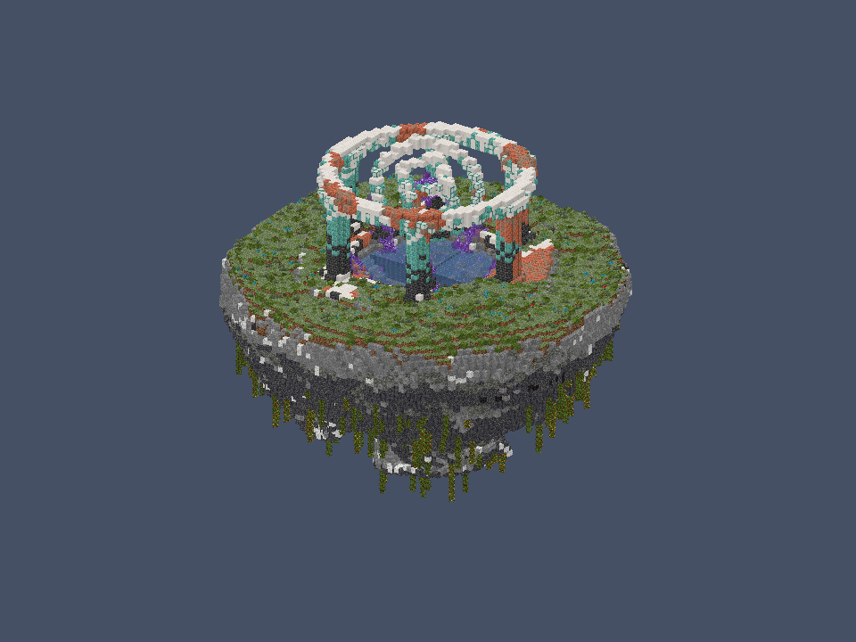
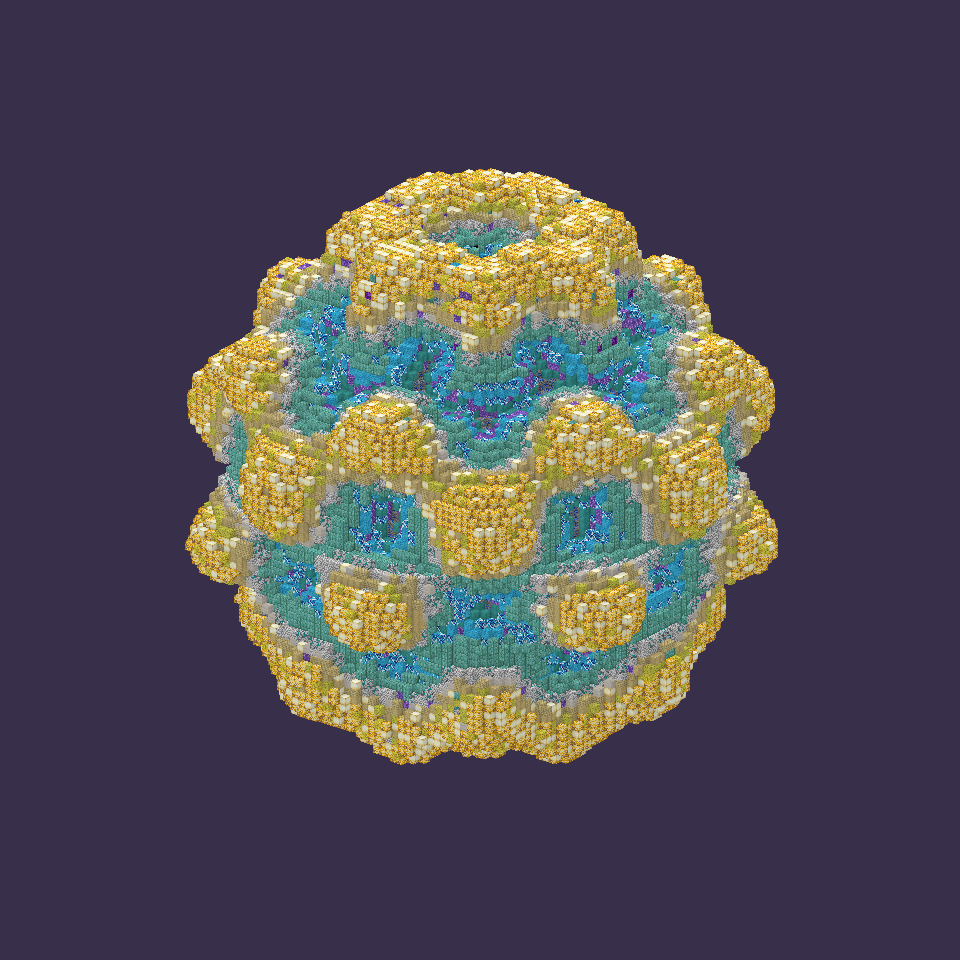
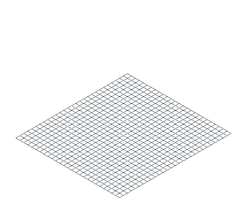
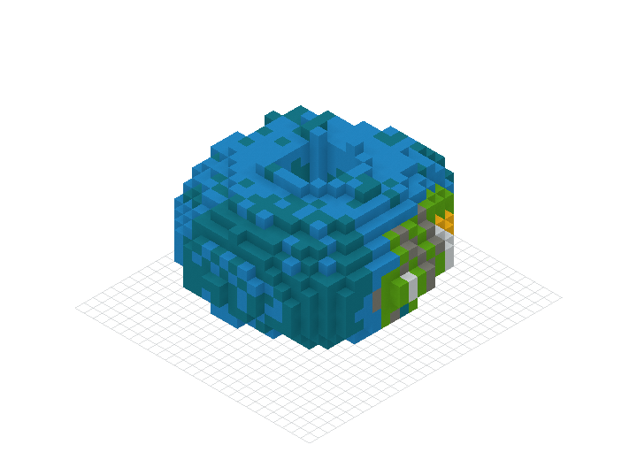

# SDFs, terrain, and fields

Nucleation models procedural 3D geometry, scalar noise, cellular patterns, and
custom mathematical formulas with a single composable type: **`Field`**.

When interpreted as geometry, a `Field` is a signed distance field (SDF) where
negative values lie inside the surface, zero lies on the surface, and positive
values lie outside. When interpreted as data, the exact same `Field` drives
surface displacement, domain warping, material gradients, biome masks, fluid
cavities, or scatter probability.

Because `Field` is an immutable, `Arc`-shared DAG compiled into a flat
instruction tape with common-subexpression elimination (CSE), sharing one noise
or heightmap subgraph across geometry, displacement, and five material layers
evaluates it **once per voxel** instead of six times.

<div class="sdf-studio" data-sdf-workbench>
  <noscript>
    <p>Enable JavaScript to run the live WebAssembly SDF and VoxelPipeline workbench in the browser.</p>
  </noscript>
</div>

Every slider move, preset switch, or `Field.expr` edit compiles, voxelizes, and greedy-meshes a real Minecraft schematic in WebAssembly. Drag to orbit or export the live `.schem` directly.

---

## Architecture at a glance

<figure class="sdf-diagram" data-adaptive-diagram data-dark="../../media/features/sdf-and-fields/sdf-pipeline-architecture.svg" data-light="../../media/features/sdf-and-fields/sdf-pipeline-architecture.light.svg">
  <picture>
    <source media="(prefers-color-scheme: dark)" srcset="../../media/features/sdf-and-fields/sdf-pipeline-architecture.svg">
    
  </picture>
</figure>

Four design properties make the pipeline both flexible and fast:

1. **One unified `Field` IR**: All 21 [Íñigo Quílez](https://iquilezles.org/articles/distfunctions/) primitives, heightmaps, Value/Perlin/FBM/ridged/Worley noise, arithmetic, CSG (hard, smooth, chamfer, stepped), transforms, warps, material tags, and sandboxed infix expressions live in one composable graph.
2. **Coordinate-space CSE + `8×8×8` brick pruning**: Compiling a `Field` or `VoxelPipeline` flattens shared subgraphs into a single deduplicated instruction tape and runs conservative interval arithmetic over `8×8×8` voxel bricks — skipping provably empty air bricks in O(1) without touching a single voxel inside them.
3. **Analytic autodiff normals & demand-driven channels**: Smooth primitives, CSG, transforms, and infix expressions differentiate automatically via forward-mode dual numbers (`Dual3`), with an ULP-safe central-difference fallback for discrete noise. The rasterizer inspects your `Material` tree before running and only computes surface normals, depth below surface, curvature, or exposed-face masks when a rule actually asks for them.
4. **One rasterizer everywhere**: Schematics, `BuildingTool`, and streaming `WorldGenerator` chunks all execute the exact same `CompiledPipeline` — parallelized across column tiles via Rayon on native targets and deterministic single-threaded on `wasm32`.

---

## Showcase gallery

Two end-to-end Rust examples in the repository demonstrate what the reworked
pipeline produces in a few dozen lines of code:

<figure markdown="span">
  { width="720" }
  <figcaption><strong>The Sunken Gyroid Sanctuary</strong> (<a href="https://github.com/Schem-at/Nucleation/blob/master/examples/sdf_sanctuary.rs"><code>examples/sdf_sanctuary.rs</code></a>) — 80,915 blocks compiled to 67 CSE instructions. Combines a <code>heightmap</code> basin, chamfer-unioned terraces, polar-repeated columns, a twisted <code>Field::expr</code> gyroid spire, 5 material tags with smooth seam dithering, a <code>FluidLayer</code> pool, and top/bottom <code>ScatterRule</code> foliage.</figcaption>
</figure>

<figure markdown="span">
  { width="720" }
  <figcaption><strong>Power-8 Mandelbulb + Orbit-Trap Coloring</strong> (<a href="https://github.com/Schem-at/Nucleation/blob/master/examples/sdf_mandelbulb.rs"><code>examples/sdf_mandelbulb.rs</code></a>) — 148,566 blocks compiled to 8 CSE instructions. Written as two 18-line <code>Field::expr</code> programs (Hubbard-Douady distance estimator + spherical orbit-trap channel) driving an Oklab <code>ChannelGradient</code> across a dithered full-block palette.</figcaption>
</figure>

---

## One field, two jobs, three bindings

The field observatory uses one seeded FBM `Field` twice: it displaces an
ellipsoid's surface by up to 1.7 blocks, then colors every occupied voxel
through a dithered concrete palette. A capped cylinder cuts the central shaft,
and a torus is smooth-unioned around the equator.

Every `Field` is immutable. Each combinator returns a new handle sharing the
existing subgraph, so named intermediates remain available for evaluation,
bounds inspection, material gradients, or serialization.

=== "Python"

    ```python
    --8<-- "examples/readme/sdf-and-fields/sdf_fields.py:graph"
    ```

=== "JavaScript"

    ```javascript
    --8<-- "examples/readme/sdf-and-fields/sdf_fields.mjs:graph"
    ```

=== "Rust"

    ```rust
    --8<-- "examples/readme/sdf-and-fields/rust/src/main.rs:graph"
    ```

`to_shape()` bridges any bounded `Field` to `BuildingTool.fill`, and
`Brush.field` evaluates any `Field` as a continuous material channel:

=== "Python"

    ```python
    --8<-- "examples/readme/sdf-and-fields/sdf_fields.py:build"
    ```

=== "JavaScript"

    ```javascript
    --8<-- "examples/readme/sdf-and-fields/sdf_fields.mjs:build"
    ```

=== "Rust"

    ```rust
    --8<-- "examples/readme/sdf-and-fields/rust/src/main.rs:build"
    ```

All three bindings produce the exact same **3,175 blocks** in a `22 × 14 × 24`
volume:

<figure markdown="span">
  { width="500" }
  <figcaption>The animation records the verified schematic by Y layer directly from the sampled field.</figcaption>
</figure>

[Download the field observatory](../downloads/readme/sdf-and-fields/field-observatory.schem).

You can inspect bounds, proven scalar ranges, pointwise values, normals, and
versioned JSON round-trips from every binding:

=== "Python"

    ```python
    --8<-- "examples/readme/sdf-and-fields/sdf_fields.py:inspect"
    ```

=== "JavaScript"

    ```javascript
    --8<-- "examples/readme/sdf-and-fields/sdf_fields.mjs:inspect"
    ```

=== "Rust"

    ```rust
    --8<-- "examples/readme/sdf-and-fields/rust/src/main.rs:inspect"
    ```

<figure markdown="span">
  { width="720" }
  <figcaption>One <code>Field</code> drives both surface displacement and Oklab palette mapping without duplicating evaluation.</figcaption>
</figure>

---

## Building geometry with `Field`

### Primitives & coordinates

All geometric primitives are centered at the origin unless they take explicit
endpoints or offsets. Distances are measured in blocks.

| Category | Constructors | Notes |
| --- | --- | --- |
| Constants & axes | `constant(v)`, `coord_x()` / `x()`, `coord_y()` / `y()`, `coord_z()` / `z()` | Pure scalar inputs for math & remapping |
| Rounded & curved | `sphere(r)`, `ellipsoid(rx, ry, rz)`, `torus(major, minor)`, `capped_torus(major, minor, angle_deg)`, `link(major, minor, half_len)`, `capsule(a, b, r)`, `round_cone(a, b, r1, r2)`, `solid_angle(r, angle_deg)`, `cut_sphere(r, h)`, `cut_hollow_sphere(r, h, t)` | Exact or tight-bound IQ primitives with smooth analytic gradients |
| Cylinders & cones | `capped_cylinder(r, half_h)`, `infinite_cylinder(r)`, `capped_cone(half_h, r1, r2)`, `infinite_cone(angle_deg)` | Unbounded variants require `.bounded(...)` or explicit bounds to sample |
| Polyhedra & boxes | `box_shape(hx, hy, hz, rounding)`, `box_frame(hx, hy, hz, thickness)`, `octahedron(size)`, `hex_prism(r, half_h)`, `super_prism(hx, hy, hz, exp)`, `square_pyramid(half_base, height)` | Sharp or rounded architectural forms |
| Terrain & planes | `plane(nx, ny, nz, offset)`, `heightmap(base_y, height_field)` | `heightmap` evaluates `y - (base_y + height(x, 0, z))` |

### Noise & cellular fields

All noise generators are deterministic integer-hashed functions — identical
across Rust, Python, JavaScript/WASM, C, C++, Kotlin, and PHP.

| Constructor | Output range | Description |
| --- | --- | --- |
| `value_noise2(freq, seed)`, `value_noise3(freq, seed)` | `[-1, 1]` | Smooth 2D (XZ) / 3D lattice value noise |
| `perlin2(freq, seed)`, `perlin3(freq, seed)` | `[-1, 1]` | Quintic-fade 2D (XZ) / 3D Perlin gradient noise |
| `value_fbm3(freq, seed, octaves)` | `[-1, 1]` | 3D Value FBM (`lacunarity = 2.0`, `persistence = 0.5`) |
| `perlin_fbm2(freq, seed, octaves)`, `perlin_fbm3(freq, seed, octaves)` | `[-1, 1]` | 2D / 3D Perlin FBM |
| `ridged_fbm3(freq, seed, octaves)` | `[0, 1]` | Ridged multifractal Perlin FBM — ideal for mountain spines & veins |
| `fbm2(...)`, `fbm3(...)` | `[-1, 1]` or `[0, 1]` | Full control over `FieldNoiseBasis` (`ValueNoise` / `Perlin`), `octaves`, `lacunarity`, `persistence`, and `ridged` |
| `cells(freq, seed, jitter, mode)` | `[0, ~1.8]` or `[0, 1]` | 3D Worley/Voronoi cellular noise: `F1` (nearest seed), `F2` (second nearest), `F2MinusF1` (cell borders / cracks), `CellValue` (constant `[0, 1]` ID per cell) |

### Scalar math & blending

Every `Field` supports pointwise scalar math so you can reshape masks, blend
heightmaps, and derive material channels without writing an expression string:

- **Unary**: `neg`, `abs`, `sqrt`, `sin`, `cos`, `saturate` (clamps to `[0, 1]`)
- **Binary**: `add`, `sub`, `mul`, `div`, `min_with`, `max_with`, `add_const`, `mul_const`
- **Remapping & control**: `clamp(lo, hi)`, `smoothstep(edge0, edge1)`, `step(edge)`, `remap(in_lo, in_hi, out_lo, out_hi)`, `lerp_with(other, t)` (Rust: `lerp`), `Field.select(cond, then_field, else_field)`

### CSG combinators & surface modifiers

| Operation | Methods | Behavior |
| --- | --- | --- |
| Hard CSG | `union_with` (`union`), `intersection_with` (`intersect`), `subtract`, `xor_with` (`xor`) | Exact boolean set operations (`min`, `max`, `max(a, -b)`) |
| Smooth CSG | `smooth_union(b, k)`, `smooth_subtract(b, k)`, `smooth_intersection(b, k)` | Polynomial C1 fillet over radius `k > 0` |
| Architectural CSG | `chamfer_union(b, r)`, `chamfer_subtract(b, r)`, `chamfer_intersection(b, r)`, `steps_union(b, r, n)` | 45° beveled joints (`chamfer_*`) and terraced staircases (`steps_union`) |
| Surface modifiers | `rounded(r)`, `shell(thickness)`, `elongate(hx, hy, hz)` | Offset outward by `r`, hollow to `abs(d) - thickness`, or stretch center |
| Displacement | `displace(offset_field, amplitude)`, `displace_noise(amplitude, freq, seed, octaves)` | Adds `amplitude * offset_field(p)` to distance and automatically expands conservative AABB bounds |

### Interactive CSG, dual normals & `8×8` brick pruning

Drag either shape handle (`A` or `B`) directly on the field, switch CSG operators, and hover anywhere to inspect `d(p)` and the unit normal `∇f`. Dashed red bricks are provably empty air (`interval_min > 0`) and skipped in O(1) without testing any voxel inside them.

<div class="sdf-csg" data-sdf-csg-lab>
  <noscript>
    <p>Enable JavaScript to interact with the 2D signed distance field, CSG operator, and 8×8 interval brick pruning explorer.</p>
  </noscript>
</div>

### Domain transforms, repetition & warps

| Operation | Methods | Notes |
| --- | --- | --- |
| Rigid & scale | `translate(x, y, z)`, `rotate(rx_deg, ry_deg, rz_deg)`, `scale(s)`, `scale_xyz(sx, sy, sz)` | Uniform `scale` preserves exact Euclidean distance; `scale_xyz` applies conservative lower-bound scaling |
| Symmetry | `mirror(FieldAxis::X/Y/Z)`, `mirror_plane(nx, ny, nz, offset)` | Folds space across an axis or arbitrary plane |
| Repetition | `repeat_infinite(sx, sy, sz)`, `repeat_counted(sx, sy, sz, nx, ny, nz)`, `repeat_polar(count)`, `repeat_points(offsets)` | `repeat_polar` arranges `count` copies radially around Y; `repeat_points` stamps at exact `(x, y, z)` coordinates |
| Nonlinear warps | `twist(amount)`, `bend(amount)`, `warp(dx, dy, dz, strength)`, `warp_noise(strength, freq, seed, octaves)` | Evaluates child field at warped coordinates `p + strength * offset(p)` |
| Metadata & bounds | `tag(material_id)`, `bounded(min_x, min_y, min_z, max_x, max_y, max_z)` | `tag` propagates a `u16` material ID through CSG & transforms; `bounded` attaches an explicit AABB for unbounded fields |

---

## Infix expression language (`Field.expr`)

Whenever a surface or scalar pattern is easier to express as math — gyroids,
fractals, trigonometric lattices, custom falloffs, or multi-field formulas —
write it directly in Nucleation's sandboxed infix expression language.

Expressions parse into a statically type-checked, provably terminating bytecode
VM that runs natively in Rust across **every language binding** with zero FFI
callbacks. Expressions are automatically differentiated with forward-mode
`Dual3` dual numbers for smooth surface normals (falling back cleanly to
central differences if discrete noise intrinsics are called).

### Syntax & types

- **Types**: `Scalar` (`f32`), `Vec3` (`[f32; 3]`), and `Bool`
- **Built-in position variables**: `p` (`Vec3`), plus scalar aliases `x`, `y`, `z`
- **Vector construction & swizzles**: `vec3(a, b, c)`, `.x`, `.y`, `.z`
- **Statements**:
  - `let name = expr;` — declare a typed local variable
  - `name = expr;` — mutate a local variable
  - `for i in 0..N { ... }` — statically bounded loop (`1 <= N <= 4096`, where `i` is a `Scalar` loop index `0.0 .. N - 1`)
  - `if cond { break; }` — early exit inside a `for` loop
  - Final expression (no trailing semicolon) is the `Scalar` return value
- **Conditional expression**: `if cond { a } else { b }` (evaluates as a typed branchless `Select` on `Scalar` or `Vec3`)
- **Operators** (standard precedence):
  - Unary: `-a`, `!cond`
  - Multiplicative: `*`, `/`, `%` (supports `Scalar * Vec3`, `Vec3 * Scalar`, `Vec3 / Scalar`, and component-wise `Vec3` ops)
  - Additive: `+`, `-`
  - Comparisons: `<`, `<=`, `>`, `>=`, `==`, `!=`
  - Logical: `&&`, `||`

### Built-in functions

| Group | Functions |
| --- | --- |
| Scalar math | `abs(s)`, `sqrt(s)`, `ln(s)` / `log(s)`, `exp(s)`, `sin(s)`, `cos(s)`, `tan(s)`, `asin(s)`, `acos(s)`, `atan2(y, x)`, `floor(s)`, `ceil(s)`, `fract(s)`, `sign(s)`, `pow(a, b)`, `min(a, b)`, `max(a, b)`, `clamp(x, lo, hi)`, `mix(a, b, t)` / `lerp(a, b, t)`, `smoothstep(e0, e1, x)`, `step(edge, x)`, `smin(a, b, k)`, `smax(a, b, k)`, `saturate(x)` |
| Vector math | `vec3(x, y, z)`, `length(v)`, `dot(a, b)`, `cross(a, b)`, `normalize(v)`, `abs(v)`, `min(a, b)`, `max(a, b)`, `mix(a, b, t)` / `lerp(a, b, t)` |
| Noise intrinsics | `value_noise(p, seed)`, `perlin(p, seed)`, `fbm(p, freq, seed, octaves)`, `ridged(p, freq, seed, octaves)`, `worley(p, freq, seed)` |
| Primitive intrinsics | `sphere(p, r)`, `box(p, half_extents_vec3)`, `torus(p, major, minor)`, `cylinder(p, r, half_h)`, `capsule(p, a_vec3, b_vec3, r)`, `plane(p, normal_vec3, offset)` |

### Binding external `Field` subgraphs

With `FieldExprBuilder` (Rust: `Field::expr_with`), you can bind any existing
`Field` DAG by name and reference it either at the current point (`base`) or at
any transformed `Vec3` coordinate (`base(q)`):

=== "Python"

    ```python
    from nucleation import Field, FieldDistanceKind, FieldExprBuilder

    core = Field.torus(10.0, 3.0)
    warp = Field.perlin_fbm3(0.08, seed=7, octaves=3)

    b = FieldExprBuilder.create()
    b.bind("core", core)
    b.bind("warp", warp)
    b.set_bounds(-16, -8, -16, 16, 8, 16)
    b.set_distance_kind(FieldDistanceKind.Estimate)

    sculpted = b.compile("""
        let twist = y * 0.12;
        let q = vec3(
            x * cos(twist) - z * sin(twist),
            y,
            x * sin(twist) + z * cos(twist)
        );
        core(q) + warp * 1.4
    """)
    ```

=== "JavaScript"

    ```javascript
    import { Field, FieldDistanceKind, FieldExprBuilder } from "nucleation";

    const core = Field.torus(10.0, 3.0);
    const warp = Field.perlinFbm3(0.08, 7, 3);

    const b = FieldExprBuilder.create();
    b.bind("core", core);
    b.bind("warp", warp);
    b.setBounds(-16, -8, -16, 16, 8, 16);
    b.setDistanceKind(FieldDistanceKind.Estimate);

    const sculpted = b.compile(`
      let twist = y * 0.12;
      let q = vec3(
        x * cos(twist) - z * sin(twist),
        y,
        x * sin(twist) + z * cos(twist)
      );
      core(q) + warp * 1.4
    `);
    ```

=== "Rust"

    ```rust
    use nucleation::sdf::{Aabb, DistanceKind, Field};

    let core = Field::torus(10.0, 3.0)?;
    let warp = Field::perlin_fbm3(0.08, 7, 3)?;

    let sculpted = Field::expr_with(
        r#"
            let twist = y * 0.12;
            let q = vec3(
                x * cos(twist) - z * sin(twist),
                y,
                x * sin(twist) + z * cos(twist)
            );
            core(q) + warp * 1.4
        "#,
        vec![("core".into(), core), ("warp".into(), warp)],
        Some(Aabb::new([-16.0, -8.0, -16.0], [16.0, 8.0, 16.0])?),
        DistanceKind::Estimate,
    )?;
    ```

### Power-8 Mandelbulb in 18 lines

Bounded `for` loops and `if cond { break; }` make iterative fractals concise and
fast across every language:

=== "Python"

    ```python
    from nucleation import Field, FieldDistanceKind, FieldExprBuilder

    b = FieldExprBuilder.create()
    b.set_bounds(-1.3, -1.3, -1.3, 1.3, 1.3, 1.3)
    b.set_distance_kind(FieldDistanceKind.Estimate)

    bulb = b.compile("""
        let z = p;
        let dr = 1.0;
        let r = 0.0;
        for i in 0..12 {
            r = length(z);
            if r > 4.0 { break; }
            let theta = acos(clamp(z.z / max(r, 1e-6), -1.0, 1.0)) * 8.0;
            let phi = atan2(z.y, z.x) * 8.0;
            dr = pow(max(r, 1e-6), 7.0) * 8.0 * dr + 1.0;
            let zr = pow(max(r, 1e-6), 8.0);
            z = vec3(sin(theta)*cos(phi), sin(phi)*sin(theta), cos(theta)) * zr + p;
        }
        let rs = max(r, 1e-6);
        0.5 * log(rs) * rs / max(dr, 1e-6)
    """).scale(32.0)
    ```

=== "JavaScript"

    ```javascript
    import { FieldDistanceKind, FieldExprBuilder } from "nucleation";

    const b = FieldExprBuilder.create();
    b.setBounds(-1.3, -1.3, -1.3, 1.3, 1.3, 1.3);
    b.setDistanceKind(FieldDistanceKind.Estimate);

    const bulb = b.compile(`
      let z = p;
      let dr = 1.0;
      let r = 0.0;
      for i in 0..12 {
        r = length(z);
        if r > 4.0 { break; }
        let theta = acos(clamp(z.z / max(r, 1e-6), -1.0, 1.0)) * 8.0;
        let phi = atan2(z.y, z.x) * 8.0;
        dr = pow(max(r, 1e-6), 7.0) * 8.0 * dr + 1.0;
        let zr = pow(max(r, 1e-6), 8.0);
        z = vec3(sin(theta)*cos(phi), sin(phi)*sin(theta), cos(theta)) * zr + p;
      }
      let rs = max(r, 1e-6);
      0.5 * log(rs) * rs / max(dr, 1e-6)
    `).scale(32.0);
    ```

### Sandbox budgets & `DistanceKind`

Expressions can safely be accepted from untrusted callers or serialized across
processes because compilation enforces strict static bounds:

| Limit | Maximum |
| --- | --- |
| Source length | 64 KiB (`65,536` bytes) |
| Local variable slots | 128 |
| Static bytecode instructions | 4,096 |
| Loop nesting depth | 8 |
| Loop iteration count `N` | `1 ..= 4,096` |
| Worst-case dynamic steps | 200,000 |

Classify custom expressions honestly via `FieldDistanceKind` (`DistanceKind` in Rust):

| `FieldDistanceKind` | Meaning |
| --- | --- |
| `Exact` | True Euclidean signed distance (`|∇f| = 1`) |
| `LowerBound` | Conservative distance lower bound (`|∇f| <= 1`) — safe for interval pruning |
| `Estimate` | Approximate distance near the surface (e.g., Mandelbulb DE, warped SDFs) |
| `Implicit` | Only sign (`<= 0` inside) and zero isosurface are meaningful (e.g., gyroids) |

---

## Composable materials & `VoxelPipeline`

`BuildingTool.fill` with a single `Brush` works great for uniform or
gradient-painted volumes. For multi-material worlds, stratified cliffs, biome
caps, water pools, and surface foliage, use **`VoxelPipeline`**:

<figure class="sdf-diagram" data-adaptive-diagram data-dark="../../media/features/sdf-and-fields/sdf-material-facemask.svg" data-light="../../media/features/sdf-and-fields/sdf-material-facemask.light.svg">
  <picture>
    <source media="(prefers-color-scheme: dark)" srcset="../../media/features/sdf-and-fields/sdf-material-facemask.svg">
    
  </picture>
</figure>

### Channels (demand-driven)

Materials read continuous properties at every occupied voxel through `Channel`
(`FieldChannel` in bindings). The pipeline scans your material tree at compile
time and **only evaluates channels that are actually used**:

| Channel | Value | Computed only when referenced? |
| --- | --- | --- |
| `WorldX`, `WorldY`, `WorldZ` | Voxel center coordinates | Free |
| `Distance` | Signed distance `d <= 0` at voxel center | Free (already computed for occupancy) |
| `DepthBelowSurface` | Vertical blocks below the column's solid top surface (`0` at surface) | Yes (column scan) |
| `NormalY` | Upward component `ny` in `[-1, 1]` of the surface normal | Yes (dual autodiff / gradient) |
| `Slope` | `1 - clamp(ny, 0, 1)` in `[0, 1]` (`0` = flat top, `1` = vertical wall or overhang) | Yes (dual autodiff / gradient) |
| `Curvature` | Mean curvature estimate (`< 0` convex ridges/edges, `> 0` concave crevices) | Yes (7-tap Laplacian) |
| `Field(f)` | Any arbitrary `Field` (noise, Worley, orbit trap, biome mask), merged into the shared CSE graph | Yes (compiled once with geometry) |

### Conditions & exposed-face masks

Use `Condition` (`MaterialCondition` in bindings) to gate material layers and
scatter rules:

| Condition | Matches when… |
| --- | --- |
| `Always` | Every voxel |
| `And(a, b)`, `Or(a, b)`, `Not(a)` | Boolean combinations |
| `MaterialTag(id)` | The winning geometry branch carries `.tag(id)` |
| `ChannelRange { channel, min, max }` | Channel value is within `[min, max]` (shortcuts: `y_range`, `depth_below_surface`, `slope_range`, `curvature_range`, `field_range`) |
| `NormalDot { dir, min, max }` | Dot product of unit surface normal with `dir` lies in `[min, max]` |
| `ExposedFace { mask, require_all }` | One (`require_all = false`) or all (`require_all = true`) neighbors in the 6-bit face mask are air |
| `Chance { probability, seed }` | Deterministic spatial hash at `(x, y, z)` falls below `probability` in `[0, 1]` |

The 6-bit `face_mask` constants are:

| Bit | Value | Direction |
| --- | --- | --- |
| `POS_X` | `1` (`1 << 0`) | East (`+X`) |
| `NEG_X` | `2` (`1 << 1`) | West (`-X`) |
| `POS_Y` | `4` (`1 << 2`) | Top (`+Y`) |
| `NEG_Y` | `8` (`1 << 3`) | Bottom (`-Y`) |
| `POS_Z` | `16` (`1 << 4`) | South (`+Z`) |
| `NEG_Z` | `32` (`1 << 5`) | North (`-Z`) |
| `ANY_SIDE` | `51` (`1\|2\|16\|32`) | Any horizontal face |
| `ANY` | `63` | Any of the 6 neighbors is air |

### Material combinators

| Material | Purpose |
| --- | --- |
| `Solid(block)` | Fixed `BlockState` (supports block properties like `minecraft:cave_vines_plant[berries=true]` in Rust via `BlockState::with_property` or block-state strings) |
| `Skip` | Leave the voxel as air (useful for carving conditional cutouts inside a layer stack) |
| `Color(r, g, b, palette)` | Snap a single RGB color through a `Palette` (ordered dithering respected) |
| `ChannelGradient` / `FieldGradient` | Map a `Channel` or `Field` over `[lo, hi]` through multi-stop RGB/Oklab stops into a `Palette` |
| `ChannelRamp` / `FieldRamp` | Quantize a `Channel` or `Field` over `[lo, hi]` directly into an ordered list of block IDs |
| `Weighted(entries, seed)` | Deterministic weighted random block palette (great for stone/cobble/andesite weathering) |
| `Shaded` / `Spotlight` | Surface-normal directional or cone-lit shading snapped through a `Palette` |
| `Brush(brush)` | Wrap any existing `Brush` (`LinearGradient`, `Bilinear`, `PointGradient`, `FieldBrush`, etc.) |
| `Layers(rules, default)` | First-match ordered stack of `(Condition, Material)` rules with a fallback default |
| `MatchTag { cases, default, blend_seams, seed }` | Dispatch by geometry `.tag(id)` — with `blend_seams: true`, smooth-CSG seams between two tagged solids dither organically across the blend zone instead of forming a hard stair-stepped border! |

### Fluids & surface scatter

- **`FluidLayer`**: Fills every air voxel inside a region (either below a constant `y_level` via `add_fluid_level(y, block)` or wherever an arbitrary `Field <= 0` via `add_fluid(field, block)`) without overwriting solid terrain.
- **`ScatterRule`**: Runs after solids and fluids are placed. For every solid voxel with an exposed neighbor on `ScatterFace` (`Top`, `Bottom`, `Side`, or `Any`), tests its `Condition` and optional `on_block` prefix (e.g. `"minecraft:moss_block"`), then places `block` (or a vertical column of length `[min_height, max_height]` for vines, stalactites, sugar cane, or pillars) into adjacent air voxels.

### Complete `VoxelPipeline` example

=== "Python"

    ```python
    from nucleation import (
        Field,
        FieldChannel,
        Material,
        MaterialBuilder,
        MaterialCondition,
        ScatterFace,
        ScatterRule,
        VoxelPipeline,
    )

    # 1. Tagged geometry: displaced island (tag 1) + carved crystal core (tag 2)
    noise = Field.perlin_fbm3(0.06, seed=42, octaves=4)
    island = Field.ellipsoid(22, 10, 22).displace(noise, 3.0).tag(1)
    spire = Field.octahedron(7.0).translate(0, 9, 0).tag(2)
    scene = island.smooth_union(spire, 2.5)

    # 2. Layered rock/moss terrain material for tag 1
    terrain_mat = MaterialBuilder.create_layered()
    terrain_mat.add_layer(
        MaterialCondition.exposed_face(4, True)  # +Y (top) exposed to air
            .and_with(MaterialCondition.slope_range(True, 0.0, True, 0.35)),
        Material.solid("minecraft:moss_block"),
    )
    terrain_mat.add_layer(
        MaterialCondition.depth_below_surface(True, 1.0, True, 3.0),
        Material.solid("minecraft:dirt"),
    )
    terrain_mat.set_default(
        Material.channel_ramp(
            FieldChannel.WorldY,
            -12.0,
            10.0,
            '["minecraft:deepslate","minecraft:tuff","minecraft:stone","minecraft:andesite"]',
            True,
        )
    )

    # 3. Dispatch by geometry tag with smooth seam dithering
    matcher = MaterialBuilder.create_tag_matcher(blend_seams=True, seed=99)
    matcher.add_tag_case(1, terrain_mat.build())
    matcher.add_tag_case(2, Material.solid("minecraft:amethyst_block"))
    matcher.set_default(Material.solid("minecraft:stone"))

    # 4. Assemble pipeline: solids + water level + grass scatter
    pipe = VoxelPipeline.create(scene, matcher.build())
    pipe.add_fluid_level(-2.0, "minecraft:water")

    flowers = ScatterRule.create(
        ScatterFace.Top, 0.25, '["minecraft:short_grass"]', [1.0], 17
    )
    flowers.set_on_block("minecraft:moss_block")
    pipe.add_scatter(flowers)

    schem = pipe.to_schematic("mossy_island")
    schem.save("mossy_island.litematic")
    ```

=== "JavaScript"

    ```javascript
    import {
      Field,
      FieldChannel,
      Material,
      MaterialBuilder,
      MaterialCondition,
      ScatterFace,
      ScatterRule,
      VoxelPipeline,
    } from "nucleation";

    const noise = Field.perlinFbm3(0.06, 42, 4);
    const island = Field.ellipsoid(22, 10, 22).displace(noise, 3.0).tag(1);
    const spire = Field.octahedron(7.0).translate(0, 9, 0).tag(2);
    const scene = island.smoothUnion(spire, 2.5);

    const terrainMat = MaterialBuilder.createLayered();
    terrainMat.addLayer(
      MaterialCondition.exposedFace(4, true).andWith(
        MaterialCondition.slopeRange(true, 0.0, true, 0.35),
      ),
      Material.solid("minecraft:moss_block"),
    );
    terrainMat.addLayer(
      MaterialCondition.depthBelowSurface(true, 1.0, true, 3.0),
      Material.solid("minecraft:dirt"),
    );
    terrainMat.setDefault(
      Material.channelRamp(
        FieldChannel.WorldY,
        -12.0,
        10.0,
        '["minecraft:deepslate","minecraft:tuff","minecraft:stone","minecraft:andesite"]',
        true,
      ),
    );

    const matcher = MaterialBuilder.createTagMatcher(true, 99);
    matcher.addTagCase(1, terrainMat.build());
    matcher.addTagCase(2, Material.solid("minecraft:amethyst_block"));
    matcher.setDefault(Material.solid("minecraft:stone"));

    const pipe = VoxelPipeline.create(scene, matcher.build());
    pipe.addFluidLevel(-2.0, "minecraft:water");

    const flowers = ScatterRule.create(
      ScatterFace.Top,
      0.25,
      '["minecraft:short_grass"]',
      [1.0],
      17,
    );
    flowers.setOnBlock("minecraft:moss_block");
    pipe.addScatter(flowers);

    const schem = pipe.toSchematic("mossy_island");
    ```

=== "Rust"

    ```rust
    use nucleation::sdf::{
        face_mask, Channel, Condition, Field, FluidLayer, Material, ScatterFace, ScatterRule,
        VoxelPipeline,
    };
    use nucleation::BlockState;

    let noise = Field::perlin_fbm3(0.06, 42, 4)?;
    let island = Field::ellipsoid([22.0, 10.0, 22.0])?.displace(&noise, 3.0)?.tag(1)?;
    let spire = Field::octahedron(7.0)?.translate([0.0, 9.0, 0.0])?.tag(2)?;
    let scene = island.smooth_union(&spire, 2.5)?;

    let terrain_mat = Material::layers(
        vec![
            (
                Condition::exposed_face(face_mask::POS_Y, true)
                    .and(Condition::slope_range(0.0, 0.35)),
                Material::solid("minecraft:moss_block"),
            ),
            (
                Condition::depth_below_surface(1.0, 3.0),
                Material::solid("minecraft:dirt"),
            ),
        ],
        Material::channel_ramp(
            Channel::WorldY,
            -12.0,
            10.0,
            vec![
                BlockState::new("minecraft:deepslate"),
                BlockState::new("minecraft:tuff"),
                BlockState::new("minecraft:stone"),
                BlockState::new("minecraft:andesite"),
            ],
        )?,
    );

    let material = Material::match_tag(
        vec![(1, terrain_mat), (2, Material::solid("minecraft:amethyst_block"))],
        Material::solid("minecraft:stone"),
        true,
        99,
    );

    let pipeline = VoxelPipeline::new(scene, material)
        .with_fluid(FluidLayer::below_y(-2.0, BlockState::new("minecraft:water"))?)
        .with_scatter(
            ScatterRule::new(BlockState::new("minecraft:short_grass"), ScatterFace::Top, 0.25, 17)?
                .on_block("minecraft:moss_block"),
        );

    let schem = pipeline.to_schematic("mossy_island", None)?;
    ```

### Streaming into infinite worlds

Any `VoxelPipeline` plugs directly into `WorldGenerator.pipeline(...)` to
stream unlimited terrain chunk-by-chunk with full materials, water levels, and
scatter — see [Streaming and worlds](streaming-and-worlds.md) for chunk
streaming, `CellularSdfConfig` motif scattering, and composite worlds.

---

## Sampling bounds, voxel centers & serialization

### Voxel-center sampling and volume ceiling

Sampling tests integer voxel centers `(x + 0.5, y + 0.5, z + 0.5)`. A cell is
occupied when `field.eval_at(x + 0.5, y + 0.5, z + 0.5) <= 0.0`.

- **Auto bounds**: `field.to_shape()` and `pipeline.to_schematic(name)` infer
  conservative finite bounds from the DAG.
- **Explicit bounds**: Unbounded primitives (`plane`, `infinite_cylinder`,
  `infinite_cone`, `heightmap`, noise, unannotated `expr`) require either
  `.bounded(min_x, min_y, min_z, max_x, max_y, max_z)` or explicit
  `to_shape_bounded(...)` / `to_schematic_bounded(...)`.
- **Safety cap**: Schematic sampling rejects volumes larger than **16,777,216**
  (`256³`) voxel centers before allocation. Stream larger regions tile-by-tile
  or with `WorldGenerator.pipeline`.

### Versioned DAG JSON (`FieldGraph` v2)

`Field.to_json()` and `Field.from_json(json)` serialize the entire `Field` DAG
as a compact, deduplicated JSON graph (`"version": 2`) — shared subgraphs are
stored once and referenced by node ID, and embedded `Field.expr` programs
preserve their readable source string. Deserialization enforces a **1 MiB**
payload cap and re-validates every parameter, expression budget, and DAG
invariant before sampling.

---

## Migrating from v0.12 to v0.13

Nucleation v0.13 replaces the split `Sdf` / `Field3` / `FieldProgram` types
with the unified `Field` + `VoxelPipeline` system:

| v0.12 (removed) | v0.13 (unified) |
| --- | --- |
| `Sdf` / `SdfNode` | `Field` |
| `Field3.value_noise_fbm(freq, seed, oct)` | `Field.value_fbm3(freq, seed, oct)` (plus `perlin_fbm3`, `ridged_fbm3`, `fbm2`, `fbm3`, `perlin2/3`, `value_noise2/3`) |
| `Sdf.offset_by_field(field, amp)` | `Field.displace(field, amp)` |
| `Sdf.displace(amp, freq, seed, oct)` | `Field.displace_noise(amp, freq, seed, oct)` |
| `Sdf.warp(str, freq, seed)` | `Field.warp_noise(str, freq, seed, oct)` (or `Field.warp(dx, dy, dz, str)`) |
| `Sdf.cells(freq, seed, jitter, mode, threshold)` | `Field.cells(freq, seed, jitter, mode).add_const(-threshold)` |
| `Sdf.from_json_string(json)` | `Field.from_json(json)` (`FieldGraph` v2 JSON) |
| `FieldProgramBuilder` (stack-machine opcodes) | `Field.expr("...")` or `FieldExprBuilder` (infix math + bounded `for` loops + bound external fields) |
| `Brush.field3` / `Brush.field_sdf` / `Brush.field(json)` | `Brush.field(field, stops, colors, lo, hi, space)` |
| `Shape.sdf(json)` / `Shape.sdf_bounded(json, ...)` | `field.to_shape()` / `field.to_shape_bounded(...)` |
| Single-brush fills only | `VoxelPipeline` with `Material` (`Layers`, `MatchTag`, gradients, ramps, weighted, shaded), `FluidLayer`, `ScatterRule`, and `WorldGenerator.pipeline` |

---

## Verify the guide

The guide verifier runs the Python, JavaScript, and Rust observatory sources,
exact-diffs all three schematics, checks the 3,175-block count and `22 × 14 × 24`
dimensions, exercises v2 JSON round-trips, and validates the generated media:

```bash
./tools/verify-sdf-fields-docs.sh
```

Continue with [Palettes and color](palettes-and-color.md) for palette presets,
custom block filters, and ordered dithering, or
[Streaming and worlds](streaming-and-worlds.md) to turn a `VoxelPipeline` into
an infinite chunk-streamed Minecraft world.
