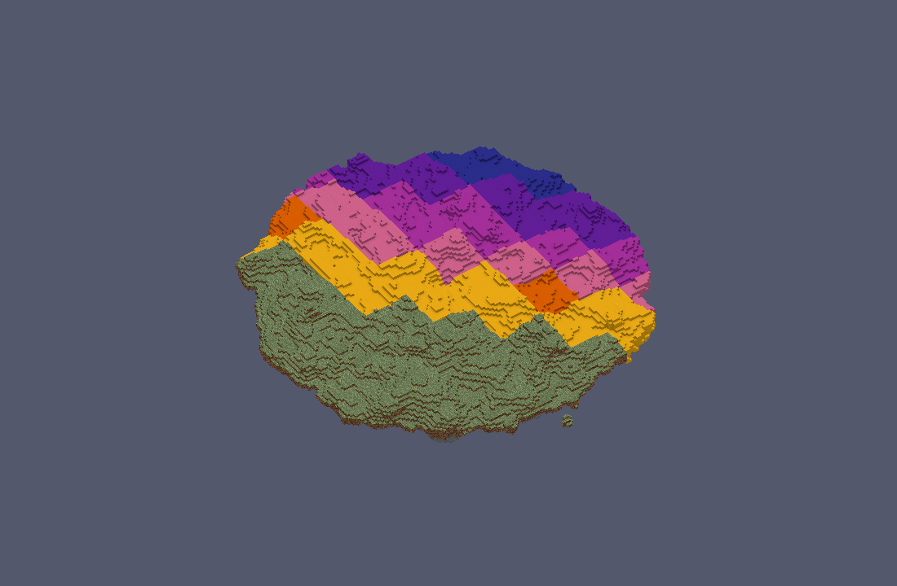
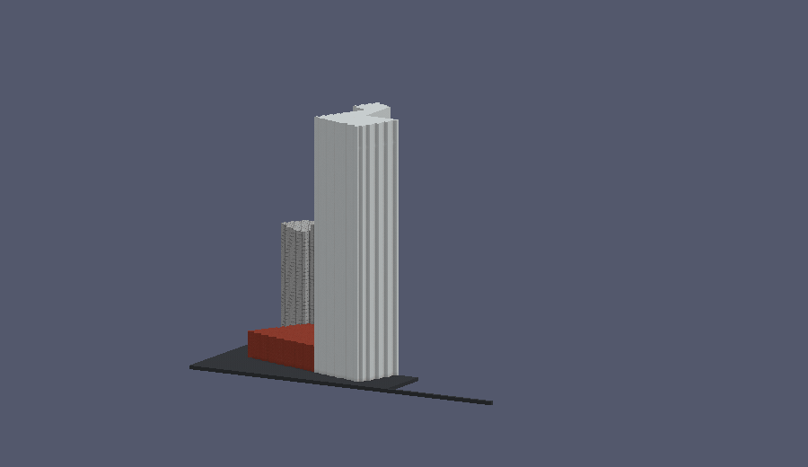
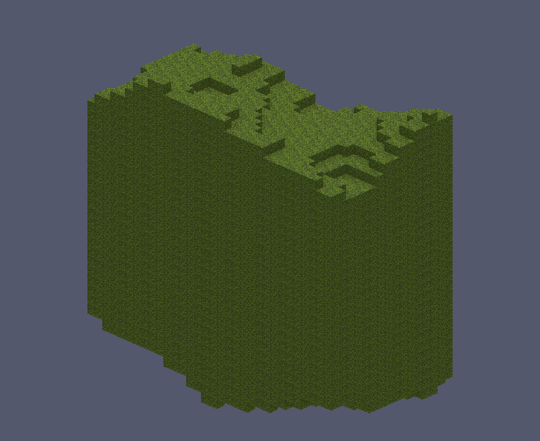

# Chunk iteration, streaming, and worlds

## Read, iterate, and stream

Any schematic splits into fixed chunks in a traversal order you choose:
`bottom_up`, `top_down`, `center_outward`, `distance_to_camera`, or `random`.
Freeze a center-outward walk 60% of the way through and the iterator's wavefront
reads straight off the terrain: plasma-tinted columns have been visited, green
ones have not yet.



```python
import json
# Walk a build in 16×16×16 chunks, center-outward from a point:
for chunk in json.loads(s.get_chunks_with_strategy_json(16, 16, 16, "center_outward", 0, 0, 0)):
    handle(chunk["chunk_x"], chunk["chunk_z"], chunk["blocks"])
```

The same idea scales past memory: stream a real world folder chunk-by-chunk and
write a transformed copy, with only one chunk resident at a time. RAM stays flat
whether the world is 10 MB or 10 GB.

```python
from nucleation import WorldStream, WorldSink

stream = WorldStream.open_dir("world/")     # or .from_zip(bytes), or *_bounded(...)
sink   = WorldSink.create("world-out/", "")
while True:
    try:
        chunk = stream.next()               # a WorldChunkView
    except Exception:
        break                               # end of stream is signalled by raising
    # inspect or edit here: chunk.set_block(...), chunk.to_schematic(), ...
    sink.write_chunk(chunk)
sink.finish()
```

---

## Generate infinite SDF worlds on demand

`WorldStream` reads persisted chunks. `WorldGenerator` is the generative twin:
an immutable native chunk source graph that synthesizes any chunk `(cx, cz)`
directly from absolute world coordinates `(x + 0.5, y + 0.5, z + 0.5)`. A
request never allocates a scratch full-world `Schematic`, and portable bindings
never call host code per voxel.

### Live WebAssembly infinite chunk streamer

Try `WorldGenerator.pipeline`, `WorldGenerator.cellularSdf`, and
`WorldGenerator.composite` directly in the browser with real Minecraft blocks.
Pan to negative or distant chunk coordinates, toggle individual `16×16` chunks
on or off, stream a `3×3` wave in canonical region-major order, or click
**Load pack .zip** to render with your own resource pack:

<div class="sdf-worldgen" data-worldgen-lab>
  <noscript>
    <p>Enable JavaScript to run the live WebAssembly WorldGenerator chunk streamer in the browser.</p>
  </noscript>
</div>

### How SDF world streaming works

<figure class="sdf-diagram" data-adaptive-diagram data-dark="../../media/features/streaming-and-worlds/worldgen-sdf-streaming.svg" data-light="../../media/features/streaming-and-worlds/worldgen-sdf-streaming.light.svg">
  <picture>
    <source media="(prefers-color-scheme: dark)" srcset="../../media/features/streaming-and-worlds/worldgen-sdf-streaming.svg">
    
  </picture>
</figure>

Every `WorldGenerator` request runs the exact same compiled CSE graph and
`8×8×8` conservative interval brick pruner as schematic voxelization:

- **Zero chunk-border seams**: Continuous `Field` graphs evaluate in absolute
  world coordinates. Surface-face predicates (`ExposedFace`) and column depth
  scans probe across the `±1` border neighborhood, and `CellularSdfConfig`
  automatically expands its candidate search halo to neighboring cells whose
  motifs can cross into the requested chunk.
- **Flat O(1) memory**: `source.stream(min_cx, min_cz, max_cx, max_cz)` yields
  one `GeneratedChunk` at a time in canonical region-major order (`32×32` Anvil
  regions), so `WorldSink` flushes each `.mca` file once and never reopens it.
- **Explicit provenance & coverage**: Every `GeneratedChunk` carries
  caller-supplied `source_id` + `version` plus one of three coverage states:
  - `Complete`: the source defines the entire requested chunk, including air.
  - `Partial`: the source contributes sparse data inside the chunk.
  - `Outside`: the request is outside available coverage (distinct from air).

---

## Stream a full `VoxelPipeline` world (terrain, 3D caves, water & scatter)

Whereas `WorldGenerator.sdf` pairs one `Field` with a single `Brush`,
**`WorldGenerator.pipeline`** runs a complete multi-material
[`VoxelPipeline`](sdf-and-fields.md#composable-materials-voxelpipeline) inside
every chunk column — including `heightmap` elevation, 3D `Field.expr` cave
carving, `ExposedFace` + `Slope` + `WorldY` biome layers, `FluidLayer` oceans
or underground aquifers, and `ScatterRule` flora or hanging vines.

=== "Python"

    ```python
    from nucleation import (
        Field,
        FieldChannel,
        Material,
        MaterialBuilder,
        MaterialCondition,
        ScatterFace,
        ScatterRule,
        VoxelPipeline,
        WorldGenerator,
        WorldSink,
    )

    # 1. Continuous infinite terrain + 3D gyroid cave network
    hills = Field.perlin_fbm2(0.018, seed=42, octaves=5).mul_const(18.0)
    peaks = Field.ridged_fbm3(0.012, seed=99, octaves=3).mul_const(12.0)
    surface = Field.heightmap(12.0, hills.add(peaks))

    caves = Field.expr(
        "let q = p * 0.14; "
        "abs(sin(q.x)*cos(q.y) + sin(q.y)*cos(q.z) + sin(q.z)*cos(q.x)) - 0.30"
    )
    terrain = surface.subtract(caves)

    # 2. Elevation & slope biome layers + stratified bedrock
    layers = MaterialBuilder.create_layered()
    layers.add_layer(
        MaterialCondition.exposed_face(1, True)
            .and_with(MaterialCondition.y_range(True, 26.0, False, 0.0))
            .and_with(MaterialCondition.slope_range(True, 0.0, True, 0.55)),
        Material.solid("minecraft:snow_block"),
    )
    layers.add_layer(
        MaterialCondition.exposed_face(1, True)
            .and_with(MaterialCondition.y_range(True, 4.0, True, 26.0))
            .and_with(MaterialCondition.slope_range(True, 0.0, True, 0.50)),
        Material.solid("minecraft:grass_block"),
    )
    layers.add_layer(
        MaterialCondition.depth_below_surface(True, 1.0, True, 3.0)
            .and_with(MaterialCondition.y_range(True, 3.0, True, 24.0)),
        Material.solid("minecraft:dirt"),
    )
    layers.set_default(
        Material.channel_ramp(
            FieldChannel.WorldY,
            -32.0,
            24.0,
            '["minecraft:deepslate","minecraft:tuff","minecraft:stone","minecraft:andesite"]',
            True,
        )
    )

    # 3. Ocean fluid layer + surface grass & cave glow-vines
    pipe = VoxelPipeline.create(terrain, layers.build())
    pipe.add_fluid_level(4.0, "minecraft:water")

    grass = ScatterRule.create(
        ScatterFace.Top, 0.20, '["minecraft:short_grass","minecraft:fern"]', [0.75, 0.25], 17
    )
    grass.set_on_block("minecraft:grass_block")
    pipe.add_scatter(grass)

    # 4. Stream a 16×16 chunk world directly to playable Anvil files in flat RAM
    source = WorldGenerator.pipeline(pipe, -32, 64, "example:alpine-caves", "v1")
    sink = WorldSink.create("alpine-world/", "")
    stream = source.stream(-8, -8, 7, 7)
    while stream.remaining() > 0:
        sink.write_chunk(stream.next().take_view())
    sink.finish()
    ```

=== "JavaScript"

    ```javascript
    import {
      Field,
      FieldChannel,
      Material,
      MaterialBuilder,
      MaterialCondition,
      ScatterFace,
      ScatterRule,
      VoxelPipeline,
      WorldGenerator,
    } from "nucleation";

    const hills = Field.perlinFbm2(0.018, 42, 5).mulConst(18.0);
    const peaks = Field.ridgedFbm3(0.012, 99, 3).mulConst(12.0);
    const surface = Field.heightmap(12.0, hills.add(peaks));
    const caves = Field.expr(
      "let q = p * 0.14; abs(sin(q.x)*cos(q.y) + sin(q.y)*cos(q.z) + sin(q.z)*cos(q.x)) - 0.30",
    );
    const terrain = surface.subtract(caves);

    const layers = MaterialBuilder.createLayered();
    layers.addLayer(
      MaterialCondition.exposedFace(1, true)
        .andWith(MaterialCondition.yRange(true, 4.0, false, 0.0))
        .andWith(MaterialCondition.slopeRange(true, 0.0, true, 0.5)),
      Material.solid("minecraft:grass_block"),
    );
    layers.setDefault(
      Material.channelRamp(
        FieldChannel.WorldY,
        -32.0,
        24.0,
        '["minecraft:deepslate","minecraft:tuff","minecraft:stone","minecraft:andesite"]',
        true,
      ),
    );

    const pipe = VoxelPipeline.create(terrain, layers.build());
    pipe.addFluidLevel(4.0, "minecraft:water");

    const source = WorldGenerator.pipeline(pipe, -32, 64, "example:alpine-caves", "v1");
    const chunk = source.generate(-3, 7);
    const schem = chunk.takeView().toSchematic();
    ```

=== "Rust"

    ```rust
    use nucleation::sdf::{
        face_mask, Channel, Condition, Field, FluidLayer, Material, ScatterFace, ScatterRule,
        VoxelPipeline,
    };
    use nucleation::world_generation::{ChunkSource, SdfChunkSource, WorldGenerator};
    use nucleation::BlockState;
    use std::sync::Arc;

    let hills = Field::perlin_fbm2(0.018, 42, 5)?.mul_const(18.0)?;
    let peaks = Field::ridged_fbm3(0.012, 99, 3)?.mul_const(12.0)?;
    let surface = Field::heightmap(12.0, hills.add(&peaks))?;
    let caves = Field::expr(
        "let q = p * 0.14; abs(sin(q.x)*cos(q.y) + sin(q.y)*cos(q.z) + sin(q.z)*cos(q.x)) - 0.30",
    )?;
    let terrain = surface.subtract(&caves);

    let material = Material::layers(
        vec![
            (
                Condition::exposed_face(face_mask::TOP, true)
                    .and(Condition::y_range(Some(4.0), None))
                    .and(Condition::slope_range(0.0, 0.5)),
                Material::solid("minecraft:grass_block"),
            ),
        ],
        Material::channel_ramp(
            Channel::WorldY,
            -32.0,
            24.0,
            vec![
                BlockState::new("minecraft:deepslate"),
                BlockState::new("minecraft:tuff"),
                BlockState::new("minecraft:stone"),
                BlockState::new("minecraft:andesite"),
            ],
        )?,
    );

    let pipeline = VoxelPipeline::new(terrain, material)
        .with_fluid(FluidLayer::below_y(4.0, BlockState::new("minecraft:water"))?)
        .with_scatter(
            ScatterRule::new(BlockState::new("minecraft:short_grass"), ScatterFace::Top, 0.20, 17)?
                .on_block("minecraft:grass_block"),
        );

    let source = SdfChunkSource::from_pipeline(pipeline, -32, 64, "example:alpine-caves", "v1")?;
    let generator = WorldGenerator::new(Arc::new(source));
    let chunk = generator.generate(-3, 7)?;
    ```

---

## Single-brush SDF, cellular motifs, footprints & composition

### Simple `WorldGenerator.sdf`

When one `Field` and one `Brush` are all you need, `WorldGenerator.sdf` wraps
them into a chunk source directly:

```python
from nucleation import (
    Brush, Field, GeneratedChunkCoverage, WorldGenerator, WorldSink,
)

terrain = Field.plane(0.0, 1.0, 0.0, -12.0).displace_noise(3.0, 0.04, 42, 4)
source = WorldGenerator.sdf(
    terrain,
    Brush.solid("minecraft:stone"),
    -32,
    64,
    "example:terrain",  # stable source identity
    "recipe-v1",        # data/recipe version for cache identity
)

# Deterministic random access; requests may arrive in any order.
generated = source.generate(-3, 7)
assert generated.cx() == -3 and generated.cz() == 7
assert generated.coverage() == GeneratedChunkCoverage.Complete
chunk = generated.take_view()  # existing WorldChunkView / WorldSink contract

# Export remains explicitly finite and lazy in canonical region-major order.
sink = WorldSink.create("world/", "")
stream = source.stream(-8, -8, 7, 7)  # inclusive chunk bounds
while stream.remaining() > 0:
    sink.write_chunk(stream.next().take_view())
sink.finish()
```

Because the SDF evaluator is `f32`, requests beyond exact half-integer
voxel-center precision fail instead of silently aliasing neighboring blocks.

### Non-periodic hashed landmarks with `WorldGenerator.cellular_sdf`

`WorldGenerator.cellular_sdf` turns any **bounded** `Field` motif (a spire,
fractured escarpment, floating island, ruin, or timber cabin) into an infinite,
non-periodic hashed-cell source. Signed cell coordinates deterministically
select X/Z jitter, yaw rotation, horizontal scale, vertical offset, and
optional feature presence. Reusing one `CellularSdfConfig` across multiple
layers keeps a cliff, waterfall, path, and cabin spatially coordinated without
modulo-wrapping the world:

```python
from nucleation import Brush, CellularSdfConfig, Field, WorldGenerator

cells = CellularSdfConfig.create(
    192, 160, 0x6A09E667,  # cell dimensions and world seed
    14.0, 10.0, 13.0,     # maximum X/Z jitter and yaw
    0.88, 1.14,            # horizontal scale range
    -2, 3,                 # vertical offset range
    1, 1, 0,               # presence ratio and feature salt
)
landmark = WorldGenerator.cellular_sdf(
    Field.sphere(24.0), Brush.solid("minecraft:stone"),
    -32, 64, cells, "example:landmarks", "recipe-v1",
)
```

The motif must expose conservative finite, non-empty bounds. Chunk generation
uses checked 64-bit anchor/candidate arithmetic, expands to the necessary
neighboring-cell halo, enforces a fixed candidate budget, culls transforms whose
bounds miss the request, and clips all writes to the requested chunk and
configured Y interval. Cellular evaluation subtracts each integer cell anchor
before converting the small local delta to `f32`, preserving voxel-center
precision at legal extreme world coordinates and rotating surface normals back
to world space for shaded brushes. `feature_salt` changes only presence
selection, so optional layers can share transforms while varying independently.

### Projected footprints & ordered `WorldGenerator.composite`

`WorldGenerator.projected_footprints` accepts the same projected-footprint JSON
used by `Geo.extrude_footprints`, spatially clips work to the requested chunk,
and reports sparse coverage. Combine any `WorldGenerator` layers (`pipeline`,
`sdf`, `cellular_sdf`, `projected_footprints`) with `WorldGenerator.composite`:

```python
import json
from nucleation import GeneratedChunkOverlayMode, WorldGenerator

buildings = WorldGenerator.projected_footprints(
    json.dumps([
        {
            "polygon": [[15, 0], [18, 0], [18, 3], [15, 3]],
            "min_y": 1,
            "height": 12,
            "block": "minecraft:bricks",
        }
    ]),
    "",                    # optional base slab block
    "osm:city-buildings",
    "planet-2026-07-25",
)

world = WorldGenerator.composite("example:world", "v1")
world.add_layer(source, GeneratedChunkOverlayMode.Replace)
world.add_layer(landmark, GeneratedChunkOverlayMode.Replace)
world.add_layer(buildings, GeneratedChunkOverlayMode.Replace)
```

Composition is ordered and explicit. `Replace` lets later non-air voxels win;
`KeepExisting` only fills air. A composite is `Complete` if any layer is
complete, `Partial` if at least one layer contributes and none is complete, and
`Outside` if all layers are outside. Source graphs are capped at 64 direct
layers.

Native Rust integrations can implement the public `ChunkSource: Send + Sync`
trait for raster/DEM, database, object-store, network, or custom vector sources.
Those adapters return the same bounded `ChunkResult`; traversal, scheduling,
caching, cancellation, and persistence remain separate concerns.

The complete deterministic SDF + cellular motif example is
[`infinite_riverfall_world.py`](https://github.com/Schem-at/Nucleation/blob/master/examples/features/streaming-and-worlds/infinite_riverfall_world.py).
The OSM Financial District below uses the same projected-vector boundary: 179
buildings streamed one `16×16` chunk column at a time.



<div align="center">

</div>

---

## Worlds

Schematics round-trip through *playable worlds*: export a real world folder
(`level.dat` + region files), import any world back, bounded to a box or
[streamed chunk-by-chunk](#read-iterate-and-stream) in constant memory:

```python
plaza.save_world(world_dir, "")
back = Schematic.from_world_directory_bounded(world_dir, 0, 0, 0, 39, 4, 39)
```
