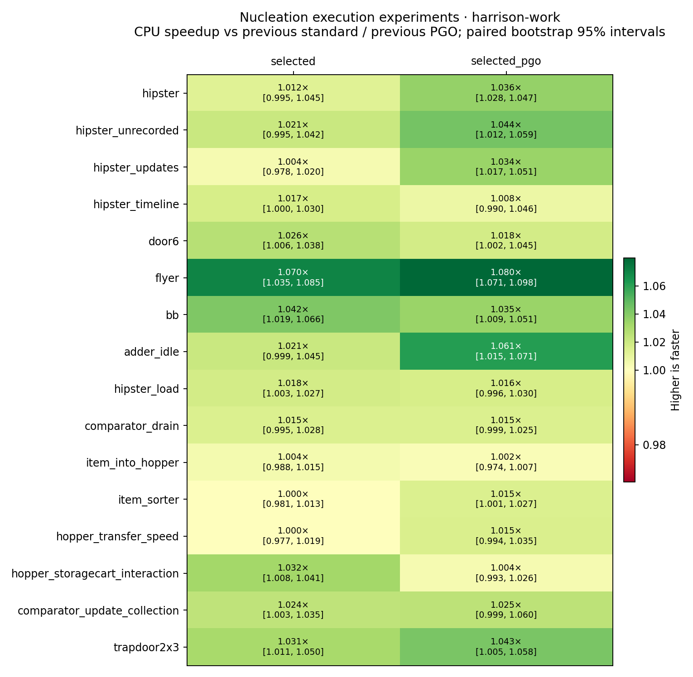
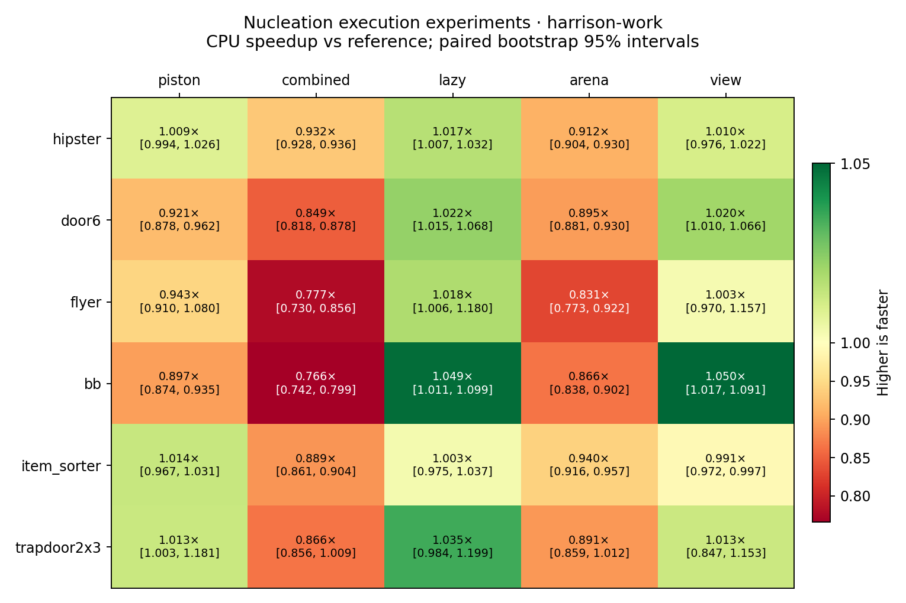

# Dynamic execution experiments

Started 15 November 2026 from `dbbfd534` on
`codex/simulation-execution-next`. All Rust compilation and native measurement
run on harrison-work; the original dirty Mac checkout is preserved. Every new
candidate is default-off. No package has been published; this report keeps rejected candidates and their measurements.

## Final result

The selected opt-in configuration adds **address records + lazy journaling** to
the previous directional-query, notification-pool and world-owned wire-plan features.
The arena and both piston-plan implementations failed the performance gate and
remain disabled. All experimental features remain off by default.

Fresh hipster results, 320 ticks with ordinary recording, from one interleaved
21-round comparison on harrison-work:

| Build | CPU ms/cycle | Elapsed ms/cycle | Elapsed simulated TPS |
| --- | ---: | ---: | ---: |
| Previous selected | 10.2917 | 10.3289 | 30,981 |
| Address records + lazy journal | 10.1647 | 10.1969 | 31,382 |
| Previous selected + PGO | 8.9571 | 8.9877 | 35,604 |
| Address records + lazy journal + PGO | 8.6474 | 8.6701 | 36,909 |
| Feature-free reference + PGO | 12.4561 | 12.4961 | 25,608 |

With PGO applied to both builds, this round adds **1.036× [1.028, 1.047]**
CPU throughput on hipster and **1.080× [1.071, 1.098]** on the small flyer.
Without PGO the hipster gain is unresolved: **1.012× [0.995, 1.045]**.
There are no resolved regressions against the corresponding previous selection
across these 16 workloads; that is not a universal performance guarantee.

Against the feature-free PGO engine, the updated selection is **1.440×
[1.429, 1.463]** on hipster. The small flyer changes from a resolved regression
in the previous PGO selection, **0.966× [0.946, 0.981]**, to **1.043×
[1.030, 1.058]**. This resolves that measured regression in this run. Some other
feature-free comparisons remain uncertain, including falling-item collection
and hopper/storage-cart interaction; their point estimates are still slightly
slower. The feature-free reference already contains the recovered earlier
optimizations: it is **not v0.12.2**.

**The requested further 10× has not been achieved.** The measured hipster result
is about **36,900 headless simulated TPS**, excluding rendering and construction.
Do not compare it directly with historical cloud-host TPS or multiply uncertain
speedups from different sampling periods.

## Final full-suite comparison

Both columns show this round's selected changes divided by the matching previous
configuration; PGO is applied to both sides of the PGO comparison. Values are
CPU speedup ratios with paired bootstrap 95% intervals. Higher is faster.

| Workload | Standard | PGO |
| --- | ---: | ---: |
| hipster | 1.0125× [0.9948, 1.0448] | 1.0358× [1.0281, 1.0469] |
| hipster_unrecorded | 1.0211× [0.9951, 1.0423] | 1.0437× [1.0122, 1.0586] |
| hipster_updates | 1.0041× [0.9776, 1.0203] | 1.0344× [1.0167, 1.0511] |
| hipster_timeline | 1.0168× [0.9995, 1.0305] | 1.0077× [0.9904, 1.0465] |
| door6 | 1.0264× [1.0061, 1.0377] | 1.0177× [1.0020, 1.0451] |
| flyer | 1.0702× [1.0352, 1.0845] | 1.0798× [1.0709, 1.0979] |
| bb | 1.0416× [1.0188, 1.0656] | 1.0349× [1.0094, 1.0511] |
| adder_idle | 1.0209× [0.9986, 1.0452] | 1.0613× [1.0150, 1.0705] |
| hipster_load | 1.0177× [1.0025, 1.0274] | 1.0165× [0.9958, 1.0299] |
| comparator_drain | 1.0146× [0.9953, 1.0280] | 1.0146× [0.9989, 1.0254] |
| item_into_hopper | 1.0045× [0.9875, 1.0150] | 1.0024× [0.9745, 1.0070] |
| item_sorter | 1.0003× [0.9809, 1.0130] | 1.0145× [1.0013, 1.0272] |
| hopper_transfer_speed | 1.0000× [0.9767, 1.0192] | 1.0155× [0.9941, 1.0354] |
| hopper_storagecart_interaction | 1.0319× [1.0085, 1.0413] | 1.0042× [0.9928, 1.0255] |
| comparator_update_collection | 1.0243× [1.0026, 1.0347] | 1.0246× [0.9988, 1.0597] |
| trapdoor2x3 | 1.0312× [1.0113, 1.0498] | 1.0429× [1.0050, 1.0580] |



The run contains **1,680 observations: 5 variants ×16 workloads ×21 rounds**.
Every subprocess has an untimed warmup. Variants are randomized within each
case/round (seed 20261114), pinned to permitted CPU 0, with shared iteration
counts calibrated toward 150ms. CPU uses ThreadTime; elapsed uses Instant.
Inputs, stepping and the requested recording are timed; setup, restoration,
fingerprinting, rendering and destruction are excluded. Loading is a separate
case. No observations are discarded. Intervals use 10,000 paired bootstrap
resamples of ratios of medians, without a multiple-comparison correction.

Host: AMD Ryzen AI 9 HX 370; Rust 1.98.0 (`88d9e12ae`), LLVM 22.1.8;
locked dependencies, opt-level 3, LTO, release debug 1, generic x86-64.
All three PGO variants use the same broad training recipe. Trapdoor, hopper
transfer speed and comparator collection are held out. No builds, profiles or
vanilla servers run concurrently with final native timings. CPU time removes
descheduling, not frequency changes or other host contention.

[Raw measurements](results/final-timings.jsonl), [paired analysis](results/final-summary.json),
[feature-free PGO comparisons](results/final-feature-free-comparison.json),
[all medians and TPS](results/final-medians.json), [build metadata](metadata/final-builds.json),
and [SVG graph](results/final-speedups.svg) preserve the complete result.

## Flying-machine regression investigation

A fresh paired pilot reuses the previous four final binaries, plus the same
selected PGO binary with wire plans disabled at process start. Five variants,
three cases and nine rounds produce 135 measured samples. No builds or profilers
ran during that native comparison.

The selected PGO flyer measures 0.944× [0.927, 0.985] against the PGO reference.
Disabling wire plans in that exact binary measures 1.008× [0.974, 1.028] relative
to plans enabled: no resolved improvement. The counters-only flyer command
produces no plan-cache report, consistent with no wire-plan cache initialization.
Thus wire-plan evaluation is not supported as the cause. The experiment does not
yet distinguish always-on bookkeeping, changed layout or PGO code generation.

For contrast, turning plans off on hipster measures 0.682× [0.672, 0.701]
relative to enabled plans in the same binary. Do not use the flyer result to
infer that caching contributes nothing to wire-heavy builds.

[Raw pilot](results/regression-timings.jsonl) and
[paired analysis](results/regression-summary.json) retain all samples.

## Candidates under test

- `experiment-lazy-journal`: defer mutation history until a plan consumer exists.
- `experiment-execution-view`: bounded plan address records with live state reads
  and invalidation on geometry changes.
- `experiment-update-arena`: eager notification payloads in reusable storage,
  preserving callback-visible queues, nested order and generic custom behaviour.
- `experiment-piston-plan`: structural piston power inputs with live comparator
  and dust emissions, including quasi-connectivity.

The previous selected configuration remains available as
`experiment-directional,experiment-update-pool,experiment-world-plan-cache`.
The feature-free reference and the prior checkpoint branch are also preserved.

## Randomized differential verification

`bench_circuits --fuzz 8` applies 96 deterministic operations for each of eight
seeds across seven real fixtures: hipster, small flyer, comparator drain,
falling-item hopper collection, sorter, storage cart and 2×3 trapdoor.
Operations interleave lever use, inventory edits, live comparator output writes
across the u8 domain, block placement, world growth, and checkpoint cloning and
restoration. A separate deterministic generator chooses operations; simulation
RNG seeding is explicit.

Each operation hashes world/tick/queue state, live comparator outputs, motion,
inventories and entities, and every newly delivered ordered record. Every
sequence is replayed and compared both by trace fingerprint and complete final
checkpoint equality. Candidate JSON is compared with the feature-free binary.
These are differential regression checks, not newly captured vanilla behavior.


## Initial validation and six-case pilot

The integrated candidate passes 458 engine/scenario/doc tests (7 ignored),
30 bridge tests and the wasm check: 488 passing tests before the fresh vanilla
corpus was added. Arena-only and piston-only feature configurations also pass
253 and 260 library tests respectively; these overlap and are not added to the
integrated total. All six candidate/reference configurations match 15 expanded
workload records and 56 randomized sequence records against the feature-free
reference. Each randomized sequence is also replayed with full checkpoint equality.

The first native pilot has 6 variants ×6 cases ×9 paired rounds =324 samples,
100ms calibration, CPU0, seed20261114, equal iteration counts and warmups.
No builds, profilers or vanilla servers ran concurrently with native timings.

Arena slows hipster to 0.912× [0.904,0.930], the 6×6 door to 0.895×
[0.881,0.930], the flyer to 0.831× [0.773,0.922], and BB to 0.866×
[0.838,0.902]. It remains a disabled experiment. The compact range stack and shared payload storage do not improve throughput
in this implementation; the measurements do not isolate each overhead source.

The first piston plan gives unresolved hipster improvement (1.009×
[0.994,1.026]), but slows the 6×6 door to 0.921× [0.878,0.962] and BB to
0.897× [0.874,0.935]. Inspection identifies a full 256-slot invalidation scan
on structural writes. A subsequent candidate checks bounded mutation history
only for the queried entry, distance-filters changes before classification, and
rebuilds conservatively on history loss. Its counters describe per-entry replay,
not unique world writes. Both versions remain reproducible from source archives.

Lazy journaling measures 1.017× [1.007,1.032] on hipster and 1.018×
[1.006,1.180] on the flyer. Address records have unresolved hipster improvement
(1.010× [0.976,1.022]) and a small sorter regression, 0.991× [0.972,0.997].
These pilot findings require confirmation and do not justify enabling all features.



[Raw samples](results/pilot-timings.jsonl), [analysis](results/pilot-summary.json),
and [exact build metadata](metadata/pilot-builds.json) retain the comparison.

## Hardware-counter evidence

Hardware counters are available on harrison-work. The separate
`tools/perf_tick_counters.py` runner uses Linux perf_event_open for userspace
cycles, instructions, branches, branch misses and cache misses. Its counters
cover complete subprocesses, including setup and warmup, unlike the tick timers.
Nine randomized rounds compare the old PGO reference/selected binaries and
standard selected/lazy binaries, each with `flyer 1 512`. All counters ran without
multiplexing. No builds or profilers ran concurrently.

Selected PGO retired 1.7% fewer instructions than its PGO reference while still
showing the native timing regression. Its cache-miss count was 1.246×
[1.093,1.880], but the total was small; cycle and branch-miss ratios were unresolved.
This supports investigating code/memory layout but does not establish a unique
cause. Lazy journaling retired 3.1% fewer instructions on the standard flyer;
that is not a promised wall-time gain. Separate Callgrind runs likewise count
333,138,635 →328,187,224 instructions for the old PGO pair, with `flyer 1 64`.

[Raw hardware counters](results/flyer-counters.jsonl),
[paired counter ratios](results/flyer-counter-ratios.json), and
[compressed Callgrind profiles](https://github.com/Schem-at/Nucleation/tree/v0.12.3/docs/performance/execution-next/profiles) preserve the evidence.

## New independent vanilla references

A retained Minecraft 1.21.11 runtime was recovered read-only from the original
checkout and verified against Mojang hashes. An isolated Temurin 21.0.13 runtime
ran the new GameTestServer probe on harrison-work, with zero players.
Two authored native-version 4671 circuits and their negative controls each
produced 40 tick-end snapshots: hopper/barrel comparator draining and piston
quasi-connectivity. The feature-free engine matches all four captures, including
blocks, occupied inventory slots and live comparator outputs. These are new
vanilla observations, not comparisons solely against an earlier engine.

See [capture method, controls, hashes and reproduction](vanilla-probe.md).
This new route does not recover the old Fabric OracleMod or provide a complete
within-tick vanilla notification trace. The hipster fixture retains save version 2730.


## Revised piston plans and combination selection

A second six-case, six-variant, nine-round pilot contains another 324 samples,
now calibrated to 150ms. Per-entry validation improves the small flyer by
1.062× [1.029,1.078] and BB by 1.064× [1.055,1.093] versus the original
piston cache, but slows hipster to 0.958× [0.940,0.970] and the trapdoor to
0.904× [0.863,0.953]. It remains slower than the previous selected engine on
several cases. A smaller invalidation loop is not a general performance win.

Adding revised piston plans to address records + lazy journaling slows hipster
to 0.954× [0.914,0.993], the 6×6 door to 0.925× [0.886,0.984], BB to
0.913× [0.891,0.948], and the trapdoor to 0.894× [0.858,0.914]. Piston plans
therefore remain disabled alongside the arena. Both original and revised piston
implementations are preserved in source snapshots and commits.

**Address records + lazy journaling** is selected for final confirmation, added
to the previous directional + pool + world-owned wire-plan configuration. In
this pilot it measures 1.032× [1.004,1.042] on hipster, 1.054× [1.044,1.084]
on the flyer, and 1.057× [1.014,1.064] on BB. Other differences are smaller or
unresolved. These are same-run comparisons against the previous selected engine,
not the published release, and not ratios assembled from separate pilot periods.

[Revised samples](results/revised-timings.jsonl),
[baseline comparison](results/revised-summary.json), and
[direct incremental comparisons](results/revised-increment.json) retain the evidence.


## Final correctness and instruction checks

The complete feature matrix passes **470 engine/scenario/doc tests** (7 ignored),
including the four newly captured vanilla cases and three revised-cache tests.
The final bridge run passes **30 tests**, for **500 passing tests** across those
nonoverlapping suites. Wasm check passes. The narrower combined configuration
passes 465 engine/scenario/doc tests; this overlaps and is not added again.
Source hashes and trace comparisons are recorded in [the audit](validation/audit.json).

All new production code remains safe Rust; no runtime dependency or lockfile
change was introduced. The generic callback path and reference implementations
remain available. The original dirty checkout was used only to read the retained
vanilla runtime and was not edited or compiled.

Separate Callgrind runs compare fresh previous-selected PGO and address+lazy PGO
binaries using identical `hipster 1 2` commands: **587,409,228 →561,240,089
instructions**, approximately **4.46% fewer**. This includes one load and four
cycles including warmup; it is not a wall-time speedup estimate.
[Compressed profiles and annotations](https://github.com/Schem-at/Nucleation/tree/v0.12.3/docs/performance/execution-next/profiles/hipster) retain the evidence.

The previous and selected standard builds also emit **17,172 byte-identical
diagnostic lines** with EVENTS, WRITE, NOTIFY, SCHED and POWER enabled, SHA-256
`4614c50446f79ae5c7b9933b419bc35ae5753ca6968b0905b3ea3783cab7b2c0`.
This does not cover every internal diagnostic option. All three final PGO builds
match the 15 expanded verification records and all 56 randomized sequences.
The four new vanilla captures add 160 tick-end observations with independent
negative controls; existing hipster golden coverage remains 640 ticks. Within-tick
ordered-record equality is against the reference engine, not a complete new
vanilla notification capture.

## Dependencies, bounds and compatibility

Address records store a dense index and geometry token in eight bytes and read
the current StateId on every use. They do not memoize world values. Clone,
replacement and growth rotate identity; out-of-range positions fall back to
ordinary lookup. Token exhaustion permanently falls back instead of wrapping.
Wire plans gain eight inline addresses, up to 64KiB extra metadata for the
bounded 1,024-entry table, with no full-world address table. Lazy journaling
activates only when a consumer first asks for revision/history; earlier writes
need no history because no plan can yet depend on them. These changes retain
safe Rust and the existing Send/Sync expectations.

The rejected piston candidate stores structural relationships, reading comparator
outputs and dust emissions live. Zero output, map insertion/removal/replacement,
arbitrary u8 values, wire connection changes and QC are covered. Every queried
entry validates its bounded journal before reuse; structural changes within the
proved radius three invalidate it. Lost history, geometry/world/rules identity
changes and revision rollover rebuild conservatively. Full position/facing keys
guard the 256 slots; near signed-coordinate limits the reference path is used.
No per-tick invalidation or notification suppression is introduced.

The rejected arena uses eager coordinates and depth-first delivery. Only audited
vanilla-wire callbacks take its fast enqueue path. Custom registration revokes
that marker, and public/custom callbacks retain the observable owned update Vec.
Clone/cursor behavior, custom clear/replacement and cascade abort are exercised.
Its retained storage is capped around 1.5MiB after completion/abort; peak live
cascade storage is not bounded by that retention cap. Passing these tests did
not justify retaining it in the selected performance configuration.

## Reproduction and rollback

Run Rust commands on harrison-work from the isolated checkout. The original Mac
checkout stays untouched. Use fresh output paths; retain the existing binaries
and raw profiles. Expanded fixture acquisition, provenance and acceptance controls
are recorded in the [previous report](../execution-plans/README.md).

Build the standard reference and selected configurations, saving source archives,
compiler/binary hashes and untimed shadow/differential outputs:

```sh
export CARGO_TARGET_DIR=/home/harrison/nucleation-perf/reproduction-target
export MC_TICK_BENCH_FIXTURES=/home/harrison/nucleation-perf/expanded-fixtures
python3 tools/run_tick_experiments.py \
  --output /home/harrison/nucleation-perf/reproduction-standard \
  --fixtures "$MC_TICK_BENCH_FIXTURES" \
  --variants reference next_reference next_view_lazy --fuzz-seeds 8
```

For PGO, run `tools/build_tick_pgo.py --skip-native` separately for an empty
feature list, the previous features, and the selected features. Use a new
`--output` for each and supply `--target-dir` and `--fixtures`. The selected list is:

```text
experiment-directional,experiment-update-pool,experiment-world-plan-cache,experiment-execution-view,experiment-lazy-journal
```

The previous list omits execution-view and lazy-journal. The script records exact
commands, generic CPU flags, profile hashes and its common training recipe. The
three executed PGO manifests are in `metadata/pgo-*.json`. Source at `0b8faf73`
matches the revised source archive; earlier candidate archives preserve the
pre-revision experiments. Byte-identical rebuilt binaries are not promised:
embedded paths and PGO training can affect them. Rebuild both comparison sides.

After every build, profile, verification command and vanilla server has stopped,
the final timing command for the retained binaries is:

```sh
TICK_RUN=/home/harrison/nucleation-perf/execution-next
MC_TICK_BENCH_FIXTURES=/home/harrison/nucleation-perf/expanded-fixtures \
python3 tools/benchmark_tick.py \
  --variant previous="$TICK_RUN/first/next_reference" \
  --variant selected="$TICK_RUN/revised/next_view_lazy" \
  --variant previous_pgo="$TICK_RUN/pgo-reference/pgo" \
  --variant selected_pgo="$TICK_RUN/pgo-view-lazy/pgo" \
  --variant feature_free_pgo="$TICK_RUN/pgo-feature-free/pgo" \
  --cases hipster hipster_unrecorded hipster_updates hipster_timeline door6 flyer bb \
    adder_idle hipster_load comparator_drain item_into_hopper item_sorter \
    hopper_transfer_speed hopper_storagecart_interaction comparator_update_collection trapdoor2x3 \
  --rounds 21 --seed 20261114 --target-ms 150 --cpu 0 \
  --build-info "$TICK_RUN/final-builds.json" --output "$TICK_RUN/reproduction-timings.jsonl"
```

Use the actual permitted CPU on other hosts. Keep diagnostics, counters and
shadow recomputation disabled. Analyze and audit saved evidence without Rust:

```sh
python3 tools/analyze_tick_followup.py docs/performance/execution-next/results/final-timings.jsonl \
  --baseline previous --compare selected=previous --compare selected_pgo=previous_pgo \
  --output /tmp/execution-next-analysis.json
python3 tools/audit_tick_execution_next.py
```

The audit verifies source-archive contents and hashes, current validated source,
saved test totals, all 27 differential files, repeated vanilla captures, binary
metadata and every final sample's pairing/iteration count. It does not rerun
tests or prove arbitrary circuits correct. [Its output](validation/final-artifact-audit.json)
and [artifact checksums](SHA256SUMS.json) accompany the report. NumPy 2.3.2 and
Matplotlib 3.10.8 generated the local analysis figures; both PNGs were inspected.

Rollback is available without resetting a checkout: build with no experimental
features for the reference path, or use just the previous feature list. With
features compiled in, `MC_TICK_WIRE_PLAN=off` and `MC_TICK_PISTON_PLAN=off` bypass
the corresponding caches; `shadow` recomputes and asserts answers during untimed
checks. These process options are sampled once. Runtime off can still retain
compiled-in bookkeeping, so feature-free builds remain the clean reference.

Prior checkpoints remain on `codex/simulation-performance` (`48765c09`) and
`codex/simulation-execution-experiments` (`dbbfd534`). Use a separate worktree at
either commit for a source rollback. This branch preserves the implemented but
rejected arena/piston experiments, their patches through Git history, source
archives and measurements. No force push, package release or default enablement
is part of this work. Experimental queue scratch fields can affect explicit
`TickCtx` struct literals; the crate README documents that opt-in API boundary.
