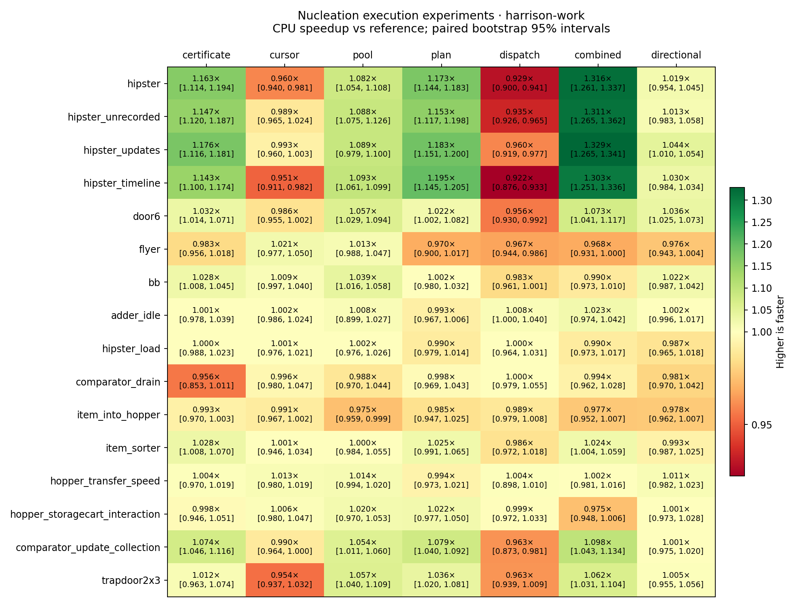

# Independently reversible simulation experiments

Prepared 15 November 2026. Base: `48765c09`, the previous optimized engine.
Branch: `codex/simulation-execution-experiments`. All Rust compilation and native
measurement use `harrison-work`; the original dirty Mac checkout is untouched.
No package release or default feature change is made by this research branch.

## Candidates and rollback

Every candidate is disabled in the reference build and can be selected separately:

| Feature | Candidate |
| --- | --- |
| `experiment-directional` | Ask only the horizontal connection question needed by emission |
| `experiment-cursor` | Share index/stride calculation inside a pure non-wire power query |
| `experiment-update-pool` | Recycle existing eager notification vectors, preserving queue layout |
| `experiment-wire-dispatch` | Direct neighbour dispatch for explicitly registered vanilla wire |
| `experiment-wire-plan` | Retain input relationships across structurally equivalent world writes |
| `experiment-wire-certificate` | Reuse a target while its actual inputs and live comparator values agree; implies plans |

The complete reference path remains available without deleting or resetting any
source:

```sh
CARGO_PROFILE_RELEASE_DEBUG=1 cargo build --locked --release --no-default-features \
  -p mc-tick --example bench_circuits
```

Add `--features experiment-directional` (or a comma-separated list) for an
experiment. `MC_TICK_WIRE_PLAN=off` bypasses plans/certificates at runtime, while
`shadow` recomputes the ordinary answer and asserts equality. Runtime off still
pays for compiled-in world journaling, so the feature-free binary is the clean
performance reference. The environment mode is sampled once per process.

The previous production checkpoint is preserved on `codex/simulation-performance`.
Switching build features or checking out that branch in a separate worktree
provides rollback without touching user edits. Feature commits and raw results
remain available even if a candidate is rejected. Experimental features are not
published API promises: notably, enabling the pool adds a scratch field to
`TickCtx` literals.

## Correctness boundaries

Notifications retain their delivery order, sequence counts and recording. Pools
retain the existing `Vec`-owning entries and eagerly captured coordinates. Typed
dispatch is installed by trusted registration, never inferred from a block name;
ordinary registration replaces it, including custom behaviours.

The cursor borrows an immutable world for one query and cannot survive a write or
growth. Its radius-two interior guard falls back to the existing boundary path.
The directional predicate specializes only concrete vanilla rules; the public
generic `WireWorld` connection calculation is unchanged. Internal side-query
diagnostics may emit fewer lines because fewer pure queries are needed.

Plans preserve six ordered non-wire groups, including the exact-strength-15 early
exit and arbitrary-u8 output semantics. Comparator map values are read live;
zero outputs, removal, insertion and map replacement cannot make a dependency
disappear. Initially unpowered comparator activation is a structural transition.
Dust levels are read live; stored dust shape is ignored only where the muted
target query's dependency proof permits it.

A world-owned 512-write journal is updated synchronously. Each query consumes
changes before reuse. Structural changes invalidate radius-two entries; the
certificate additionally tracks changes to actual incoming-wire inputs. History
loss, growth, cloning/restoration and revision rollover force fresh validity.
Owned `Arc` identities prevent address-reuse mistakes. Full position keys guard
the bounded 1,024-slot cache. Rules clones begin empty. Cache/journal state is
excluded from semantic snapshots. The existing safe Rust and `Send + Sync`
constraints remain intact.

Cross-review caught an extreme-coordinate edge: an eager plan could visit an
overflowing neighbour that the reference skips after finding strength 15. Plans
now fall back near signed-coordinate limits, with a regression exercising actual
notification delivery there.

Certificates never suppress delivery or bypass effects when the target differs
from current power. In particular, the existing notifications still occur when
a requested wire sibling state is absent.

## Measurement and interpretation

`tools/run_tick_experiments.py` records compiler, feature switches, source hashes,
binary hashes, test output and expanded differential traces. Final timings must
run after all builds and profilers have stopped, with shadow/counter builds
excluded. The randomized runner preserves every sample and pairs variants within
case/round. Confidence intervals use the existing paired bootstrap analysis.

The counter feature `experiment-wire-plan-counters` is solely diagnostic. Its
Drop reports cover a cache's complete lifetime, including setup and warmup;
these are not reset-per-cycle counts or performance measurements.

One limitation is deliberate and measured by a regression test: the initial
rules-owned cache retains one world's plans. Sixteen forced alternating-world
queries rebuild sixteen times; sixteen subsequent same-world queries rebuild
once. Concurrent queries remain correct under its mutex, but shared-rules
multi-world throughput needs separate consideration before adopting this storage
as a general default.

The previous PGO `TickCtx::drain` disassembly still contains an indirect vtable
callback (`call *%rax`); its body is 2,069 bytes. This establishes that the typed
dispatch experiment is not simply duplicating an existing guarded direct wire
call. It does not establish that the experiment is faster.

## Validation

The corrected combined source passes **439 engine/scenario/doc tests** (7 ignored),
**30 bridge tests**, and the wasm check: **469 passing tests** in total. All eight
native variants (reference, six individual candidates, and combined) match all
15 accepted tick-workload records and fingerprints, including the earlier
optimized engine's records. The hipster golden still covers 640 tick-end states
against Minecraft 1.21.11. New community cases remain functional/differential
checks rather than newly captured complete vanilla traces.

The typed table entry is 24 bytes versus 16 bytes for the previous dynamic entry.
That footprint cost is included in the native measurements; the direct-call
hypothesis does not assume it away.

An untimed counters-only `hipster 1 1` command reports 130,860 plan queries,
3,828 plan builds, 2,502 structural invalidations, 18,062 value dirty markings,
and 109,724 certificate hits. Classified writes comprise 1,862 structural,
11,228 wire-value and 4,876 irrelevant-to-this-query transitions. There are two
world resets. These are whole-command operation counts (warmup and measured-work
cycle plus setup), not CPU-time shares or timing results.

## Individual candidates: nine-round pilot

Eight binaries ×16 workloads ×9 paired rounds =1,152 measured observations.
The source is the corrected implementation for plan/certificate/combined and
identical feature-off code for the other binaries; per-build source hashes are
retained in metadata. All use the same compiler, generic release flags and harness.

Hipster CPU-time ratios against the reference, measured together:

| Candidate | Speedup | Paired 95% CI |
| --- | ---: | --- |
| Directional predicate | 1.019× | 0.954–1.045 |
| Indexed cursor | 0.960× | 0.940–0.981 |
| Buffer pool | 1.082× | 1.054–1.108 |
| Typed dispatch | 0.929× | 0.900–0.941 |
| Input plans | 1.173× | 1.144–1.183 |
| Plans + certificates | 1.163× | 1.114–1.194 |
| All six combined | 1.316× | 1.261–1.337 |

The cursor and typed dispatch are not justified as standalone defaults. The
combined result does not establish that each constituent helps; subsequent
combination comparisons remove components to test that directly. The directional
predicate's standalone hipster gain is unresolved. Input plans and pooling show
clear hipster improvements; other workloads and fresh confirmation remain part
of the selection decision.



[Raw pilot samples](results/pilot-timings.jsonl) and [analysis](results/pilot-summary.json)
retain all observations. The graph includes regressions; no outliers or losing
candidates were removed. Final selection and confirmation follow below.
