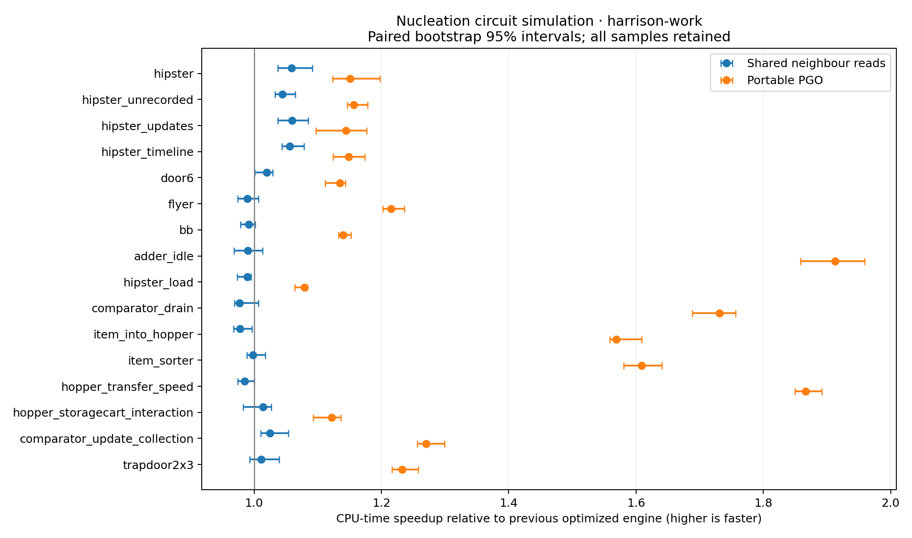

# Simulation optimization and expanded benchmarks — 15 November 2026

This follows the [reconstructed optimization checkpoint](../hipster-resumed/README.md)
and investigates the requested further order-of-magnitude improvement. All Rust
compilation, correctness runs and native measurements used `harrison-work`.
The original dirty Mac checkout was not used for edits or compilation.

**The approximately 224,000 TPS stretch target has not been achieved.** The
retained source change shares adjacent-world read arithmetic; portable
profile-guided optimization is available as an opt-in build recipe. Derived
power caches and several other alternatives were tested and rejected.
No optimized package release was made.

## Fresh results

Hipster, 320 ticks with ordinary change recording:

| Build | CPU ms/cycle | Elapsed ms/cycle | Elapsed simulated TPS | CPU speedup vs previous engine (95% CI) |
| --- | ---: | ---: | ---: | --- |
| Previous checkpoint | 14.601 | 14.646 | 21,848 | 1.000× [1.000, 1.000] |
| Retained source change | 13.789 | 13.825 | 23,147 | 1.059× [1.037, 1.091] |
| Retained source + portable PGO | 12.691 | 12.736 | 25,125 | 1.151× [1.123, 1.198] |

PGO adds **1.087× [1.061, 1.112]** on top of the retained
source change, measured directly in the same rounds. Its hipster CPU-time rate is
25,216 simulated TPS; the elapsed rate above is the
headless throughput a caller sees. This is not rendered or server TPS.

PGO versus the previous checkpoint across the expanded suite:

| Case | CPU ms/workload | Speedup (95% CI) |
| --- | ---: | --- |
| hipster | 12.6906 | 1.151× [1.123, 1.198] |
| hipster_unrecorded | 12.3837 | 1.157× [1.147, 1.178] |
| hipster_updates | 13.1644 | 1.144× [1.097, 1.177] |
| hipster_timeline | 12.5648 | 1.149× [1.124, 1.174] |
| door6 | 1.7416 | 1.135× [1.112, 1.144] |
| flyer | 0.1400 | 1.215× [1.202, 1.236] |
| bb | 7.6620 | 1.140× [1.132, 1.152] |
| adder_idle | 0.0134 | 1.913× [1.859, 1.959] |
| hipster_load | 2.3398 | 1.079× [1.064, 1.083] |
| comparator_drain | 0.0069 | 1.731× [1.689, 1.756] |
| item_into_hopper | 0.0040 | 1.569× [1.559, 1.609] |
| item_sorter | 0.7395 | 1.609× [1.580, 1.641] |
| hopper_transfer_speed | 0.4601 | 1.866× [1.850, 1.892] |
| hopper_storagecart_interaction | 0.2978 | 1.122× [1.093, 1.137] |
| comparator_update_collection | 0.3194 | 1.270× [1.257, 1.299] |
| trapdoor2x3 | 0.7129 | 1.232× [1.216, 1.258] |



[SVG figure](results/final-speedups.svg). Large gains on short or quiescent cases
are workload-specific; they do not establish comparable gains on an active
computer or door.


The standard source change concentrates its benefit on wire-heavy doors. Loading
measured 0.989× [0.974, 0.996] and the short falling-item case 0.978× [0.968, 0.997]
relative to the previous engine. Other small differences were mostly unresolved.
The PGO build improved all sixteen measured workloads, including those two; this
is not a promise for circuits absent from the suite.

## What changed

`World::neighbours` reads six adjacent states in direction-enum order. Interior
reads share coordinate conversion and bounds checks; border reads preserve air
outside the world. Strong-power queries use the resulting array without changing
query semantics or notification delivery. A regression test covers thin worlds,
negative and extreme signed coordinates, borders and growth.

The benchmark suite grows from **9 to 16 accepted workloads**. Seven additions
cover container-driven comparators, falling-item collection, item sorting,
hopper throughput, moving storage carts, order-sensitive comparator collection,
and an independently downloaded community 2×3 trapdoor. A second downloaded
4×4 shutter is quarantined because it does not fully reopen in the previous
engine either. Activity checks alone would have mistaken that failed cycle for
a functioning circuit. See [fixture provenance, controls and checks](fixtures.md).

The exporter uses the production schematic importer and preserves save versions.
The fixture preparation script pins input hashes and records output hashes.
Downloaded files remain outside Git. Verification and timed iterations reset RNG
seed 0 after setup, and each iteration restores its checkpoint outside the timer.

## Correctness

- Retained source: **416 engine/scenario/doc tests passed, 7 ignored**;
  **30 bridge tests passed**; wasm check passed. Total: **446 passing tests**.
- The previous engine, retained change and PGO build match all **15 accepted
  tick-workload fingerprints**. Loading is the sixteenth case and has no tick trace.
- Hipster verification still covers 640 ticks, 17,968 block changes and 659,770
  ordered update deliveries. Its existing Minecraft 1.21.11 golden remains green.
- Cache experiments additionally passed shadow recomputation and adversarial
  invalidation tests. The OnceLock variant passed **421 tests, 7 ignored** and the
  wasm check. This count describes the experimental source, not retained source.

The newly added community trapdoor has functional panel and full-layout cycle
assertions. The Lithium workloads check their existing accept conditions and
inventory activity. They add differential coverage; they are **not new complete
vanilla captures**. The shutter's failure is saved as a diagnostic, with no claim
about whether its cause is simulator behavior, version or placement assumptions.

[Validation logs and fingerprints](https://github.com/Schem-at/Nucleation/tree/v0.12.3/docs/performance/hipster-next/validation) retain the evidence. Cache state
was deliberately excluded from debug/semantic snapshots in experimental builds,
so matching hashes did not depend on concealing changed simulation state.

## Measurement method

Final run: 3 variants × 16 cases × 21 randomized paired rounds = **1,008 measured
observations**, plus calibration and warmups. Random seed 20261114; CPU affinity 0;
a common baseline calibration targets 150 ms CPU time per sample. All variants
use the same iteration count for a case and run an equal untimed warmup sample.
No observations are discarded. Confidence intervals use 10,000 paired bootstrap
resamples of ratios of medians across rounds.

CPU time uses `cpu_time::ThreadTime`; elapsed time uses `Instant`. Timers contain
inputs, stepping and the stated recording mode. Construction, restore, RNG reset,
recording setup, validation, fingerprinting, destruction and rendering are outside
tick timers. Parsing/building/validation is measured separately by `hipster_load`.
The idle adder is explicitly quiescent and must not be described as arithmetic
throughput. CPU time does not remove frequency changes or cache/contention effects.

Hardware: AMD Ryzen AI 9 HX 370. Rust/Cargo 1.98.0, LLVM 22.1.8. All final variants
use release optimization level 3, LTO, debug level 1, locked dependencies and
generic x86-64. Only the PGO variant adds profile-use compiler flags. Separate
Cargo target directories prevent cross-checkout artifact reuse. No builds or
profilers ran concurrently with final native timings.

Baseline engine: `7c52701dba2f1bec6c51b369a91386149e711226`, with the identical
expanded harness. This is a comparison against the **previous optimized engine**,
not another claim of speedup against v0.12.2. Historical cloud measurements are
not used in these ratios. [Raw observations](results/final-timings.jsonl),
[analysis](results/final-summary.json), [build metadata](metadata/final-builds.json)
and [fixture hashes](metadata/fixtures.json) support reproduction.

## What the search and experiments found

The [experiment report](experiments/README.md) preserves source patches, tests,
paired pilots and rejection reasons. Tested candidates include packed immutable
power metadata, no-op callback dispatch, shared wire-query reads, local wire-target
caching with mutex and OnceLock storage, constant-result cache entries, PGO and
native-CPU compilation.

The local caches invalidated a proven 25-cell dependency footprint immediately
on writes and read comparator output maps live. They passed correctness checks.
The mutex variant improved hipster only 1.049× [1.029, 1.071] over its own uncached
mode while slowing the 6×6 door to 0.972× [0.965, 0.990]. OnceLock and pre-resolved
constant entries did not repair the broad tradeoff, so none is retained.
An untimed instrumented cycle found 41,249 hits in 65,430 wire-target queries
(63.0%), but also 21,081 initializations and 20,997 effective invalidations.
A high hit rate is not a CPU-time saving.

Relevant primary sources:

- [Lithium's power-query implementation](https://github.com/CaffeineMC/lithium/blob/2f3cbe1b42c4cbe4813afee8ed837ae7f54b7ac2/common/src/main/java/net/caffeinemc/mods/lithium/common/block/redstone/RedstoneWirePowerCalculations.java)
  identifies read reuse between non-wire and wire inputs while preserving update
  delivery. The fused-query experiment independently refactored Nucleation's own
  calculations around this idea; no Java source was copied.
- [MCHPRS Redpiler design](https://github.com/MCHPR/MCHPRS/blob/master/docs/Redpiler.md)
  motivates compact indexed execution data and reducing repeated interpretation.
  A dynamically maintained per-position execution view is a further research
  direction for Nucleation, with explicit refresh on moving blocks and rule changes.
- [Logisim's connectivity/propagation investigation](https://github.com/logisim-evolution/logisim-evolution/issues/3065)
  distinguishes repeated connectivity lookups from repeated component execution.
  Lookup reuse is relevant; notification deduplication has not been justified for
  Nucleation's order-sensitive Minecraft semantics and was not implemented.
- [Rust's official PGO workflow](https://doc.rust-lang.org/rustc/profile-guided-optimization.html)
  provides the instrument/train/merge/rebuild procedure used here. Training covers
  doors, flying machines, idle stepping, sorting and hopper/cart interaction. The
  trapdoor, hopper transfer-speed and comparator collection cases are held out.

The strongest remaining avenues are a compact execution view that avoids repeated
state interpretation and an allocation pool/arena that preserves every update's
order while avoiding per-batch heap allocation. Neither is claimed implemented or
measured here. Previous inline and lazy queue experiments remain rejected; another
representation needs fresh evidence. Static topology, per-tick invalidation or
skipped notification deliveries are not substitutes for dynamic behavioral parity.

## Instruction profiles

Separate Callgrind 3.25.1 runs of `bench_circuits hipster 1 2` (one load and
four cycles including warmup) counted 977,368,745 instructions for the retained
source and 868,229,195 for its PGO build: **11.2% fewer instructions**. These are
instruction counts, not native speedups. Both runs used the same expanded harness
and ran after native timings. [Raw compressed profiles and annotation](https://github.com/Schem-at/Nucleation/tree/v0.12.3/docs/performance/hipster-next/profiles)
retain the data. Do not divide these counts by earlier report counts whose harness
or executable differed.

In the PGO profile, exclusive instruction attribution assigns at least 41.5% to
the wire neighbour callback, 15.4% to update draining, 2.6% to connection queries,
and 4.1% to allocator entry points. These groups are disjoint; the annotation's
99% coverage threshold makes the sums lower bounds. They identify where to
investigate next, not CPU-time shares or achievable speedups. The
[grouped counts](profiles/exclusive-groups.json) retain the calculation inputs.

## Reproduce the retained comparison

Prepare the fixtures as described in [fixtures.md](fixtures.md), then build the
current standard binary. Build the previous engine in a separate worktree with
the same `bench_circuits.rs` and its own Cargo target directory. Build PGO with:

```sh
rustup component add llvm-tools-preview
python3 tools/build_tick_pgo.py --output /absolute/new-pgo-output \
  --target-dir /absolute/separate-pgo-target \
  --fixtures "$MC_TICK_BENCH_FIXTURES" --skip-native
```

Run `tools/benchmark_tick.py` with three `--variant NAME=ABSOLUTE_BINARY` arguments,
`--rounds 21 --target-ms 150 --cpu <permitted CPU>`, the sixteen cases from the raw
run's calibration rows, and build metadata. Analyze with
`tools/analyze_tick_followup.py --baseline retained`; generate PNG/SVG figures with
`tools/plot_tick_benchmarks.py`. The raw file records exact binaries and parameters.
