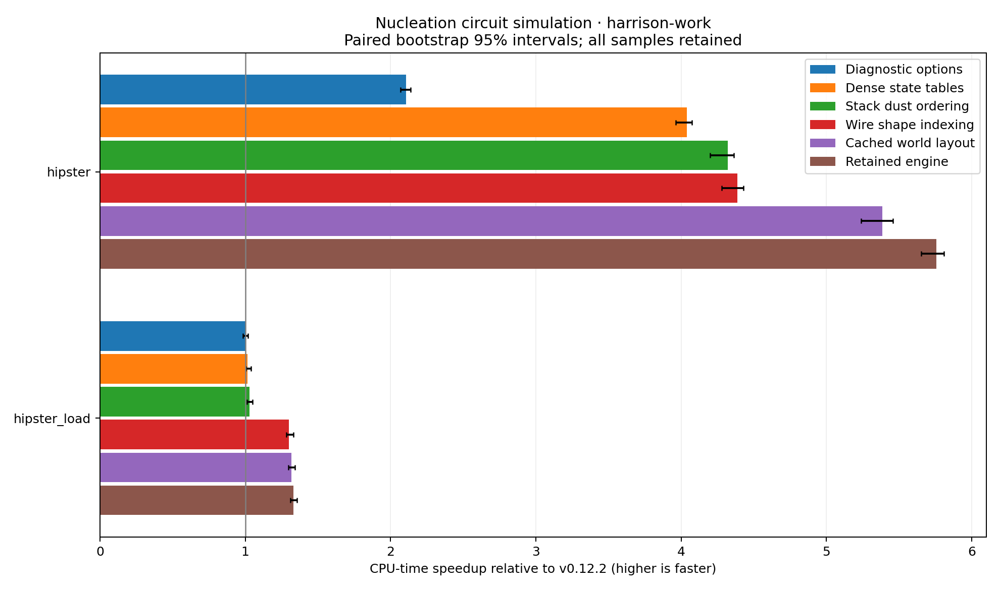
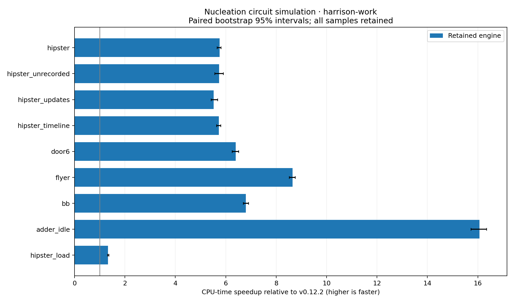
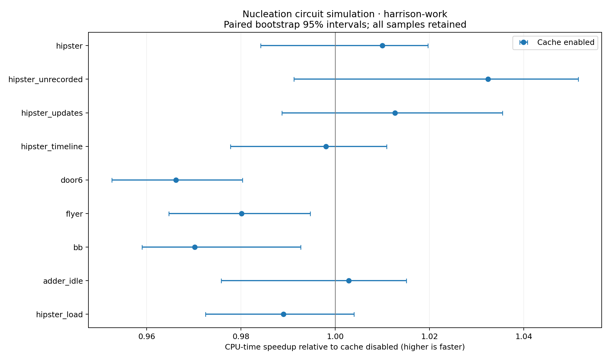

# Nucleation simulation performance — resumed 15 November 2026

The reconstructed optimizations reduce the hipster door from **81.98 to
14.24 CPU ms per 320-tick cycle**, a **5.76× speedup**
(95% paired bootstrap interval 5.653–5.810×) on **harrison-work**.
The retained elapsed median is 14.278 ms/cycle. This is approximately
22,468 simulated TPS by CPU time and 22,412 by elapsed
time, for this single-core headless workload with ordinary recording. Rendering
is excluded; these are not general Minecraft-server TPS figures.

**Both derived-power cache prototypes are rejected from production.** They pass
the tested invalidation and differential checks, but the revised cache has no
resolved hipster benefit and slows three other active workloads. Their complete
source patches, tests, raw pilot data, design, and final timings are preserved.

The production source retains changes A–G from the handoff. No optimized package
release or upstream master merge was performed. Work is on
[`codex/simulation-performance`](https://github.com/Schem-at/Nucleation/tree/codex/simulation-performance).

## Recovery and provenance

The base is `ee89008d`, current upstream master when work resumed. It includes
v0.12.2 (`836690d1`); its published piston/redstone parity fixes were preserved.
The original Mac checkout had substantial unrelated edits and was left intact.
Development used `/Users/harrison/RustroverProjects/Nucleation-simulation-performance`;
all Rust compilation, tests, native timings, and profiles ran on harrison-work.

The accessible local checkout and inspected laptop locations had no prior
optimization patches/snapshots. No connection to the former cloud disk was
available; this does **not** establish deletion. A–G were reconstructed from the
handoff, not recovered byte-for-byte. The new checkpoint source is `08175175`,
with the common embedded-fixture harness correction in `5a92c5be`.

Every number in the results below is freshly measured. Historical Xeon numbers
from 14 November are not used to compute these speedups. The historical rejected
notification-queue experiments were not reconstructed or retested.

## Fresh results

21 randomized, interleaved rounds × 9 variants × 9 cases = **1,701 observations**.
All observations are retained. The complete data and binary SHA-256 hashes are in
[`results/final-timings.jsonl`](results/final-timings.jsonl).

| Hipster stage | CPU ms/cycle | Speedup vs release | 95% interval |
|---|---:|---:|---:|
| Released engine | 81.981 | 1.000× | 1.000–1.000 |
| Diagnostic options | 38.942 | 2.105× | 2.067–2.138 |
| Dense state tables | 20.292 | 4.040× | 3.961–4.074 |
| Stack dust ordering | 18.966 | 4.323× | 4.199–4.364 |
| Indexed wire shapes | 18.682 | 4.388× | 4.278–4.428 |
| Cached world layout | 15.221 | 5.386× | 5.239–5.456 |
| Simplified power queries (retained) | 14.242 | 5.756× | 5.653–5.810 |

Incremental hipster comparisons use paired rounds directly; they are not ratios
of unrelated runs or of reported confidence limits.

| Incremental stage | Speedup vs preceding stage | 95% interval |
|---|---:|---:|
| diagnostics | 2.105× | 2.067–2.138 |
| tables | 1.919× | 1.874–1.948 |
| dust | 1.070× | 1.042–1.088 |
| wire | 1.015× | 0.998–1.042 |
| world | 1.227× | 1.189–1.260 |
| power | 1.069× | 1.043–1.100 |

The isolated wire-indexing tick gain remains unresolved. It improves loading;
its direct indexing also removes redundant sibling-map construction. No claim
of lower total memory usage is made: sparse high state IDs can use more metadata.



| Workload | Release CPU ms | Retained CPU ms | Speedup | 95% interval |
|---|---:|---:|---:|---:|
| hipster | 81.9814 | 14.2422 | 5.756× | 5.653–5.810 |
| hipster_unrecorded | 81.9475 | 14.2972 | 5.732× | 5.563–5.905 |
| hipster_updates | 82.1908 | 14.8979 | 5.517× | 5.421–5.670 |
| hipster_timeline | 81.3231 | 14.1939 | 5.729× | 5.631–5.802 |
| door6 | 12.6330 | 1.9764 | 6.392× | 6.253–6.506 |
| flyer | 1.4499 | 0.1677 | 8.645× | 8.516–8.748 |
| bb | 59.7513 | 8.7872 | 6.800× | 6.689–6.899 |
| adder_idle | 0.4028 | 0.0251 | 16.070× | 15.726–16.340 |
| hipster_load | 3.3607 | 2.5266 | 1.330× | 1.309–1.355 |

Idle-adder results describe quiescent stepping only. Recording-mode rows are
separate case blocks; their small absolute differences do not establish that
recording helps or hurts. A dedicated recording-mode experiment was not repeated.



## Cache experiment and decision

The cache stores non-comparator strong-power contributions plus a comparator
neighbour mask, and reads comparator outputs live on every query. Every attempted
world write and growth call invalidates structural entries immediately, including
within a tick. Full position/mode keys, generation rollover clearing, per-world
ownership, retained rules identity, clone/restore resets, and bounded storage
prevent the identified stale-hit paths. Send/Sync is preserved with a mutex and
uncached fallback on contention. No unsafe code or production dependency is added.
See [`experiments/cache-design.md`](experiments/cache-design.md) for the dependency
model and validation coverage.

The first prototype cached exact-strength queries only. Its nine-round pilot did
not establish a hipster gain. The second also lets boolean conductor queries
share the cache. Its same-binary enabled/disabled results are:

| Workload | Enabled-cache speedup | 95% interval |
|---|---:|---:|
| hipster | 1.010× | 0.984–1.020 |
| hipster_unrecorded | 1.032× | 0.991–1.052 |
| hipster_updates | 1.013× | 0.989–1.035 |
| hipster_timeline | 0.998× | 0.978–1.011 |
| door6 | 0.966× | 0.953–0.980 |
| flyer | 0.980× | 0.965–0.995 |
| bb | 0.970× | 0.959–0.993 |
| adder_idle | 1.003× | 0.976–1.015 |
| hipster_load | 0.989× | 0.972–1.004 |

The hipster interval includes 1, while the 6×6 door and both flyers regress.
The added invalidation, synchronization, identity, and storage complexity is
therefore not justified. Production has no cache or cache configuration API;
explicit Off/On/Shadow modes and adversarial tests remain in the experimental
patches for future investigation. This rejects this implementation, not derived
power caching in general.



## Validation and reference scope

- Released engine: 410 passing engine/scenario/doctests, 7 ignored.
- Retained engine: **415 passing engine/scenario/doctests**, 7 ignored.
- Retained bridge checks: **30 passed**. Total retained checks: **445 passed**.
- `wasm32-unknown-unknown` check passed for retained and cache sources.
- Cache prototypes: **420 passing engine/scenario/doctests**, 7 ignored, including
  comparator-map mutations, emission gates, collisions, generation rollover,
  growth, distinct worlds/rules, wire changes and warm checkpoint restore.
- Seven paired dynamic scenarios compare tick-end state, ordered changes and
  updates, inventory records/state, and entities, with cache shadow assertions.
- All staged binaries and both cache prototypes match the same eight verification
  fingerprints. Hipster covers 640 ticks, **17,968 block changes** and
  **659,770 ordered update deliveries**.
- Enabled diagnostic comparison: **17,172 byte-identical stderr lines**, SHA-256
  `4614c50446f79ae5c7b9933b419bc35ae5753ca6968b0905b3ea3783cab7b2c0`, also matching
  the historical handoff. This does not enable every internal diagnostic option.

The committed Minecraft **1.21.11** golden test covers all 640 hipster tick-end
states. Its schematic save semantics retain data version **2730**. Intra-tick
ordered differential checks use the released engine as their reference. No new
Minecraft server capture was made; the offline reference archive was not supplied
in this session. Reconstructed fingerprint serialization differs from the lost
historical harness, so hashes are compared between identical fresh harnesses.
Full logs and fingerprint rows are in [`validation/`](validation/).

## Separate instruction profiles

Callgrind 3.25.1, identical `BINARY hipster 1 2`: one load and four cycles including
warmup. These instrumented durations are **not** native timing results.

| Variant | Instructions |
|---|---:|
| Released engine | 7,497,226,802 |
| Through indexed wire shapes | 1,515,759,348 |
| Retained engine | 1,057,553,398 |
| Revised cache enabled | 972,866,000 |

The retained source executes 85.9% fewer
instructions than release, and 30.2% fewer
than the wire-indexed stage. The cache removes a further
8.0% without a resolved native hipster
speedup, demonstrating why instruction counts alone are insufficient.

The retained profile still concentrates work in wire block-signal evaluation,
world reads, notification draining, wire connection calculations, and emission.
Raw compressed profiles and annotated tables are in [`profiles/`](profiles/).
Profiler executables/packages and build caches remain outside Git. The profiler
was extracted under the task directory; no system installation was changed.

## Workloads, host and timing boundaries

AMD Ryzen AI 9 HX 370, Linux x86-64, CPU 0 (allowed set 0–23), performance governor
and energy preference. Rust/Cargo **1.98.0**, rustc `88d9e12ae`, release opt-level 3,
LTO, debug=1, generic x86-64, no target-cpu=native or PGO. All variants use the same
lockfile, harness and development-only `cpu-time = 1.0.0`; production dependencies
are unchanged. Detailed compiler/host metadata is in [`metadata/`](metadata/).

Every simulation uses `mc_test::build_sim` and RNG seed 0. Fixtures are committed
under `crates/mc-tick/tests/corpus/structures`.

| Case | Setup outside tick timer | Timed work |
|---|---|---|
| hipster | InWorld; save version 2730 | 320 ticks; lever (12,7,13) at 10 and 170 |
| hipster_unrecorded | same; discard ordinary recording | same inputs/ticks |
| hipster_updates | same; ordinary + update recording | same inputs/ticks |
| hipster_timeline | same; timeline recording | same inputs/ticks |
| door6 | InWorld | 100 ticks; lever (10,4,1) at 0 |
| flyer | Quiet; run 2, redstone at (2,1,1), run 2, remove, run 40; assert x>5 | 200 ticks |
| bb | InWorld; remove (31,7,13), run 30; assert activity | 200 ticks |
| adder_idle | Placement; run 200; assert quiescence | 500 ticks |
| hipster_load | embedded text; no fixture file I/O | parse, build, validate; drop excluded |

Tick timers include inputs, stepping, and the chosen recording. Checkpoint/RNG
reset, recording setup, verification, export, and rendering are excluded. Each
subprocess has one untimed warmup sample with the measured iteration count.
A baseline probe selects identical iterations for each case toward 150 ms/sample.
Variant order is shuffled within each case/round with seed **20261114**.
Confidence intervals use **10,000 paired bootstrap resamples of round indices**
for ratios of medians. Both CPU and elapsed samples are retained. CPU time removes
descheduling, not frequency changes, cache effects, or unrelated host activity.
No builds/profilers ran concurrently with final native sampling. Intervals are
exploratory and unadjusted for multiple workload/stage comparisons.

Diagnostic environment options now sample once per process on first use. Set
them before simulation; changes require a new process. Public recording APIs
remain dynamic, including the new `discard_recording()` method.

## Reproduction

Use this branch and Rust 1.98.0. The builder creates a **new** disposable worktree
and never resets an existing checkout. Patches are cumulative against `ee89008d`;
apply the selected stage only. Use a dedicated Cargo target directory for every
independently changing checkout: sharing targets between worktree builds can
leave the output executable belonging to another source tree.

```sh
python3 tools/prepare_tick_variants.py --output /tmp/tick-patches
python3 tools/build_tick_variants.py \
  --worktree /tmp/nucleation-tick-stages \
  --patches /tmp/tick-patches --output /tmp/tick-binaries \
  --target /tmp/nucleation-tick-stage-target
python3 tools/benchmark_tick.py \
  --variant baseline=/tmp/tick-binaries/baseline \
  --variant power=/tmp/tick-binaries/power \
  --build-info /tmp/tick-binaries/build-manifest.json \
  --cpu 0 --rounds 21 --output /tmp/tick-timings.jsonl
python3 tools/analyze_tick_followup.py /tmp/tick-timings.jsonl \
  --output /tmp/tick-summary.json
python3 tools/plot_tick_benchmarks.py /tmp/tick-summary.json \
  --variants power --output /tmp/tick-speedups
```

Select an allowed CPU. The full run adds diagnostics, tables, dust, wire, world,
cache_off, and cache_on via repeated `--variant` arguments. The cache names use
the same experimental binary; only cache_on gets `--mode cache_on=on`.
Experimental patch bases and hashes are in `experiments/manifest.json`. Build
those patches in their own checkout/target directory; verify with
`MC_TICK_POWER_CACHE=shadow BINARY --verify`. Shadow mode is forbidden in timings.

For incremental intervals, pass repeated `--compare VARIANT=REFERENCE` arguments
to the analysis script. PNG and SVG figures are retained alongside the raw data.
The original checkout, user reference files, and published packages were preserved.
