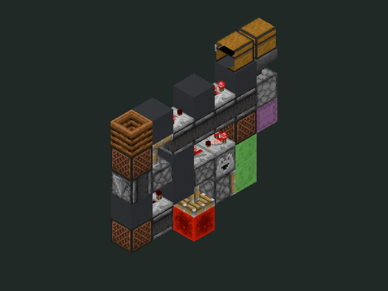
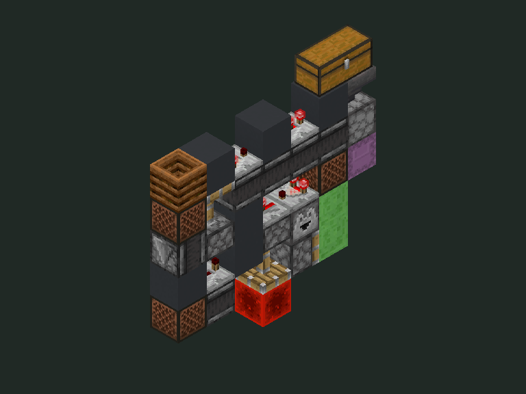
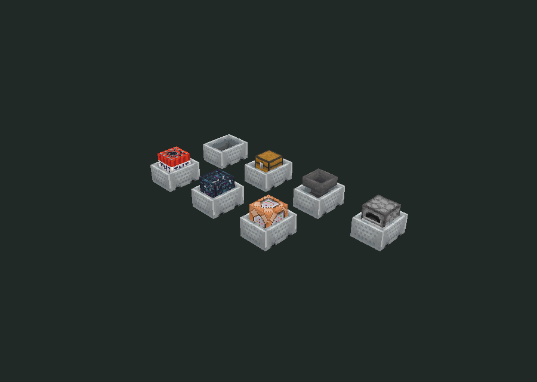

# Chest, minecart and sign rendering investigation

15 November 2026. These are rendering checks; they do not establish circuit
functionality or Minecraft simulation parity.

## Double chests

The east-facing double chest in Storage Catalog OD006 exposed its normally
hidden inner faces and left a two-pixel gap between halves. The shared entity
facing helper supplied `Ry(-90°)` for east, but in the mesher's right-handed
coordinate system that rotates the model's south-facing front toward west.
The incorrect cardinal orientation also put the half-chest latch and seam on
the wrong side.

The fix uses +90° for east and −90° for west. It is committed separately at
[`Schematic-Mesher@5550498`](https://github.com/Schem-at/Schematic-Mesher/commit/5550498f97212f6ac5a0a44c03a60e3c825fdeea),
on `codex/atlas-entity-rendering`; Nucleation pins that exact revision. Two
geometry regressions check all four front vectors and the joined bottom bounds,
combined width and outward latch positions of all four double-chest orientations.

Rust tests ran on harrison-work. The fixed mesher passes 269 tests. Five existing
geometry-count tests (bat, cat, cow, horse, wolf) still fail; the unchanged pinned
baseline `dcc0e0a` reproduces the identical five failures with 267 passing tests.
Neither those expected counts nor the models they count were changed here.

Actual original-file render targets:

| Build | Source SHA-256 |
|---|---|
| OD006 dropper display | `df827ab6d9c1c6a8af2a3964b9eb5dcdc7f18bf1ad4a705d0c17bb26c2b7227b` |
| OD006 piston display | `110014868492b3ed129481ca1b0a964f1b902db4c2191ab2259f06ac1ffb9283` |
| OD005 block swapper (north-facing control) | `51deca1b4298a22f908a83a79dd2665f99157ba6715479b4e8ec7866dec0a22e` |

The local archive retains original before images, remote result records and test
logs under `validation/rendering-repairs-v1`. Original schematics are unmodified.

All **375** previously rendered chest-containing archive entries were regenerated
on harrison-work, preserving each entry's original visualization pack. All source
and PNG hashes and image dimensions passed verification. **234** PNGs changed and
**141** were byte-identical; the north-facing OD005 control was byte-identical.
The initial batch found 25 missing duplicate-source paths on the laptop; those
exact originals were copied and all 25 retry renders succeeded. These were file
transfer omissions, not renderer or schematic failures.

## Live minecarts

Sim Lab previously deliberately drew every live entity as a translucent hitbox;
it never requested a minecart mesh. The static mesher already supported minecart
geometry and Nucleation already aliased the renamed 1.21 texture.

Sim Lab now loads real textured hulls through that mesher, with visible payloads
for chest, hopper, furnace, TNT, spawner and command-block carts. Seven immutable
templates are cached and cloned. Exact engine positions drive the instances;
the bridge now exposes the cart's existing yaw, so stopped carts retain their
orientation and movement need not be guessed from velocity. The mesh anchor is
feet-centre. This is visual representation, not a new entity physics model.

Initial and refreshed block meshes omit mobile entities, preventing a stationary
duplicate at a cart's spawn location. Async completions check identity before
attaching, so removing an entity or resetting a run cannot resurrect an old cart.
Unsupported entity types retain hitbox previews, and failed model loading retains
the hitbox with a diagnostic. Glowing fuses, payload animation and arbitrary
custom entity appearance are not implemented by this change.

`apps/sim-lab-wasm/verify-entity-models.mjs` exercises actual WASM-generated GLBs
in an isolated headless browser: all seven variants, all four yaw quadrants,
feet-centred geometry, no static duplicate, real movement and reset/recreation.
It explicitly rejects a stale engine that omits yaw. This test performs no Rust
compilation; the browser engine is built on harrison-work.

The full browser check passed with seven textured models (120–248 vertices), four
yaw quadrants and one genuinely moving cart. After eight game ticks its X position
advanced from 1.5 to 2.8930521050808315 and the displayed model matched the reported
position/yaw. Static chunk geometry matched an otherwise identical entity-free
world; clear/recreate retained a usable shared mesh. See the machine-readable
[`rendering-repairs.json`](validation/rendering-repairs.json) receipt.

## GitHub sign issue

[`Nucleation#65`](https://github.com/Schem-at/Nucleation/issues/65) is open and
proposes shared glyph geometry to reduce per-sign texture-atlas growth. The
current code still composites text into a board texture scaled fourfold on each
axis; a standard 64×32 board becomes 256×128 (128 KiB of RGBA pixels before atlas
padding). Each distinct composited tile therefore uses sixteen times the source
board's pixel area. This is an area calculation, not a measured whole-build memory
or performance result.

The proposal is relevant to the sign-heavy plot, but has not been implemented or
benchmarked in this change. A compatible implementation must preserve front/back
content, font resource-provider mappings, formatting, dyes, glow outlines and
orientation while measuring texture savings against additional geometry and draw
cost. Current text rendering is still a limited baked-text path; it should not be
described as complete Minecraft font rendering.

The separate [`#64`](https://github.com/Schem-at/Nucleation/issues/64) concerns
1.21.11 multi-axis block-model rotations. The pinned mesher already contains
Euler deserialization and X→Y→Z matrix-order regression tests for that report;
this investigation did not reimplement them.

## Saved head skins and piston presentation — 15 November 2026

The engine already reads player-head profiles, but the Atlas and Sim Lab did
not register their referenced texture PNGs. Sim Lab now registers saved skins
before building chunk atlases. Atlas caches official Mojang texture URLs under
the separate archive's `player-skins/`; standalone Sim Lab fetches HTTPS textures
directly. Old HTTP URLs are normalized. Failed downloads fall back visibly and
can be retried; name/UUID-only profiles without a saved texture URL continue to
use default skins. No original profile or schematic is edited.

The archive yielded **192 distinct saved textures**, all downloaded successfully.
With those added to a separate resource pack, the existing native renderer on
**harrison-work** regenerated **762** affected thumbnails with **zero failures**;
**691** PNGs changed. Hidden/occluded head textures need not change the rendered
pixels. Every source and PNG hash and image size passed reconciliation. No Rust
compilation or simulation ticks were needed for this refresh. The original pack,
old PNGs and prior render manifest remain available for rollback.

Piston presentation now interpolates the last completed interval. Previously,
`completedTick + fraction` first displayed a newly started stroke halfway to its
destination; the new clock includes that missing first half-step. Pause holds the
current fractional pose and resume never reverses it. Manual stepping still shows
the exact completed state. Motion remains linear and uses the engine's own
flights; simulation timing and update ordering are unchanged.

Initial block prototypes and both piston-arm lengths finish loading before the
world becomes interactive, preventing missing geometry on first activation.
Swapping or retiring a cloned arm no longer disposes geometry shared with the
prototype or other moving blocks. States introduced later can still require a
first asynchronous parse. Initial load includes this mesh preparation.

Fresh checks against the actual WASM/Three.js path:

- **808 assertions:** exact downloaded face pixels occur in the two creator
  heads' generated texture atlas; all six piston directions extend and retract
  with correct fractional positions and arm lengths; rendering matches a parallel
  engine instance at every sampled tick; shared geometry is not disposed during
  arm swaps; all final handovers retire.
- **12 clock assertions:** first-frame timing, pause/resume, manual steps,
  fast-forward, rewind and replacement simulation.
- A real UI run first painted a stroke at **0.0667 progress**, held the exact
  pose across eight paused frames, and never reversed on resume. A deliberately
  failed skin request fell back, then succeeded on retry in the same module
  session. These are presentation checks, not a new vanilla reference capture.
- Three skin URL/profile/fallback unit tests, the existing coordinate regression
  (three reported plot entries and two translated multi-region builds), and
  **22 Atlas API checks / 121 requests** passed. The JavaScript production build
  passed; Rust engine bytes are unchanged.

Reproduce with `verify-presentation-clock.mjs`, `verify-skins-motion.mjs`, and
`verify-skin-retry-pause.mjs` under `apps/sim-lab-wasm`, plus
`tools/test_player_head_skins.py`. Browser tests use an isolated headless profile
and support `CHROME_PATH`. Local detailed evidence is in
`validation/skins-motion/`; refreshed native records, prior PNGs and the prior
manifest are in `rendered-thumbnails/head-skins-v1/`. These local assets remain
outside Git.
