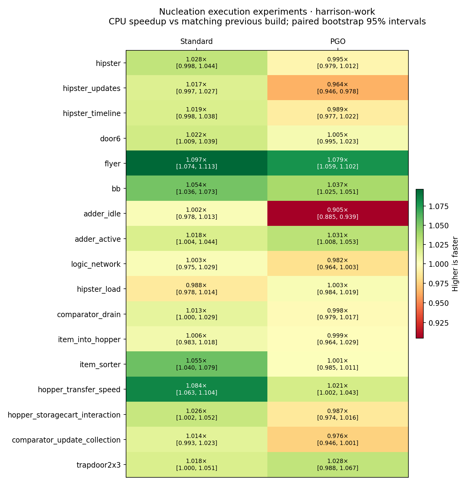
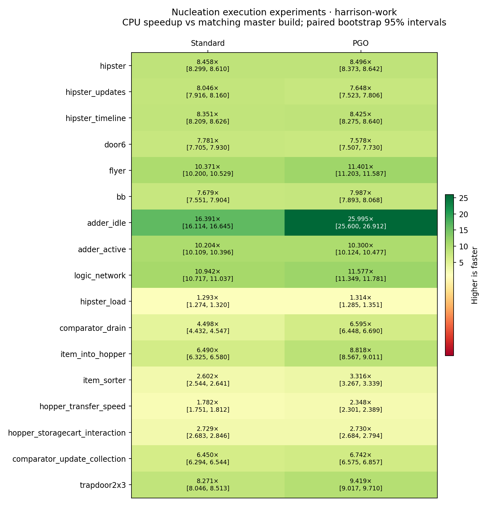

# Stationary logic, flying machines, and current master

Completed 15 November 2026 from `fac555fb` on
`codex/simulation-workload-specialization`. All Rust builds, checks and native
measurements run on harrison-work. The original dirty Mac checkout is untouched.

The freshly fetched default branch is `master`, commit
`ee89008d085a8fb0088851dcac7221ab94d2b91c`. An isolated detached checkout receives
only the common benchmark harness and cpu-time 1.0.0 dev dependency/lock entries.
Its production engine source stays unchanged. `bench_master` excludes the
unsupported unrecorded case; no recording API or optimization is backported.

Three default-off experiments were implemented and measured:

- `experiment-logic-plan-storage`: dense position indices and sparse cached wire
  plans avoid conflict misses in fixed circuitry. Live inputs, synchronous
  invalidation and the general dynamic simulation path remain intact. The index
  is bounded to 262,144 u32 cells (1 MiB); at most 32,768 sparse plan entries supplement
  the 1,024 fallback slots. Larger worlds/exhausted budgets use the prior cache.
- `experiment-moving-phase`: reuse due-move storage, remove per-landing singleton
  allocation and skip empty entity-displacement work. Selection, stable ordering,
  callbacks and live probes/entities remain authoritative.
- `experiment-transition-signatures`: compile immutable rule metadata into a
  512 KiB table, preserving exact transition classification with an uncached
  fallback and a shadow comparison mode.

New active logic cases use the existing 32-bit adder (eight input vectors across
768 ticks) and an authored four-lane comparator/repeater network (16 Gray-code
phases across 384 ticks). Exact arithmetic/signal outputs are checked from recorded
changes outside the timer. These augment idle logic, two flying machines and the
existing doors/inventory/item corpus. They are not fresh vanilla captures.

## Final results and configuration choice

The combined configuration improves active arithmetic and flying-machine
throughput over the preceding optimized build. It remains an opt-in choice for
those workloads: the previous configuration is retained for idle-heavy logic and
detailed update recording, where the combined PGO build regresses. No individual
feature or configuration is assumed to be faster on every circuit.

The following are **elapsed simulated TPS on one simulation thread**, with the
same PGO training recipe on both sides. Master means the unchanged production
engine at `ee89008d`; "new" includes all preceding optimization work plus this
round's three features. The speedup column uses paired CPU measurements and 95%
bootstrap intervals, so it can differ slightly from the rounded TPS ratio.

| Workload | Current master TPS | New configuration TPS | CPU speedup vs master [95% CI] |
|---|---:|---:|---:|
| Hipster door | 4,303 | 36,555 | 8.496× [8.373, 8.642] |
| Active 32-bit adder | 10,440 | 107,587 | 10.300× [10.124, 10.477] |
| Comparator/repeater network | 70,141 | 812,002 | 11.577× [11.349, 11.781] |
| Small flying machine | 142,275 | 1,626,500 | 11.401× [11.203, 11.587] |
| Large flying machine (BB) | 3,495 | 27,923 | 7.987× [7.893, 8.068] |

Without PGO, hipster improves from **3,781 to 31,997 TPS**, or 8.458× CPU
throughput [8.299, 8.610]. The complete results include all 17 workloads, both
compiler configurations, CPU and elapsed medians, and loading as a separate case.
These are headless simulation rates for the specified tick sequences, including
their inactive ticks and ordinary recording unless the case specifies otherwise.
They are not rendering rates or whole Minecraft server rates.

**Most of the gain over master comes from the earlier work.** This round's
incremental PGO improvements are **3.1% on active adder**, **7.9% on the small
flyer**, and **3.7% on BB**. Standard-build gains are 1.8%, 9.7% and 5.4%,
respectively. The compact logic network and ordinary hipster show no resolved
incremental improvement. Hipster PGO is 36,555 TPS versus the preceding build's
36,760 TPS; that difference is unresolved.

Two incremental PGO regressions are resolved: detailed hipster update recording
has **3.6% lower throughput** (0.964× [0.946, 0.978]), and idle adder has **9.5%
lower throughput** (0.905× [0.885, 0.939]). Both still outperform master, but the
previous optimized configuration is the better measured choice for these cases.
The standard-build comparison has no resolved regression. This experiment does
not establish another order-of-magnitude gain over the preceding optimized engine.





[Raw final samples](results/final-timings.jsonl),
[all medians and TPS](results/final-medians.json),
[incremental analysis](results/final-summary.json), and
[master comparison](results/final-master-comparison.json) retain every result.
The plots are also available as [incremental SVG](results/final-incremental-speedups.svg)
and [master-comparison SVG](results/final-master-speedups.svg).
[SHA-256 checksums](SHA256SUMS.json) cover every retained report artifact; the
audit script verifies them alongside the source, trace and measurement checks.

## Candidate pilots

The first pilot interleaves five variants across eight cases and nine rounds
(360 samples), CPU 0, seed 20261114 and 100 ms calibration. The combined storage and
movement changes give 1.096× [1.059,1.116] on the small flyer and 1.059×
[1.015,1.083] on BB versus the previous selected standard build. Active-adder
throughput increases 1.013× [1.007,1.030]; the authored network difference is
unresolved. Moving-phase alone gives a 6% sorter regression; the combination's
sorter interval crosses 1.0. These results justify measuring the combination
with PGO and the full suite, not assuming every individual switch is beneficial.

[Raw pilot](results/pilot-timings.jsonl), [analysis](results/pilot-summary.json),
and [direct combination comparisons](results/pilot-combination.json) retain all
observations and paired bootstrap intervals.

A second pilot revisits result certificates with the denser cache: four variants,
three cases and nine rounds (108 samples), 150 ms calibration. Certificates reduce
throughput to 0.896× [0.888,0.911] on active adder, 0.885× [0.842,0.892] on the
logic network and 0.916× [0.890,0.959] on hipster relative to dense plans alone.
This configuration is rejected. Preserving certificate lifetime does not make
its validation/invalidation bookkeeping worthwhile in these circuits.
[Raw certificate measurements](results/certificate-timings.jsonl) and
[analysis](results/certificate-summary.json) preserve the rejected probe.

## Exact transition metadata

`experiment-transition-signatures` compiles immutable VanillaRules metadata into
65,536 u64 signatures. Transition classification then reads two array entries
instead of repeatedly consulting separate tables. It preserves missing versus
present-zero values, all direction options, full `u8` values, wire presence and the
same distinction between structural, wire-value and irrelevant changes.
The original classifier remains available with
`MC_TICK_TRANSITION_SIGNATURES=off`; `shadow` recomputes and asserts equality.
The mode is sampled once per process, and shadow is forbidden during timings.

The 512 KiB table is lazy and shared by worlds using the same immutable rules Arc.
Rules fields are private and no public mutator exists. Construction finishes
before sharing; cloning rules resets both plan identity and signature storage.
An internal future mutation API would need to invalidate this table explicitly.
State IDs still do not identify a world or rules registry by themselves.

Warm steady-state measurements absorb first-use construction in warmup. A
separate ignored release-mode microbenchmark measures cold initialization and
warmed/reference classification for a registered mixed-logic palette. It excludes
cloning/destruction and includes loop overhead; it does not measure entire-circuit
loading or predict whole-engine speedup. InWorld loading can defer this cost until
the first activity, so a loading-only timer cannot establish that it is free.

## Validation and reproduction

The final all-feature engine/scenario/doc suite passes **481 tests**, with eight
ignored; the bridge suite passes **30**, for **511 passing tests**. Wasm check
passes. The ignored classifier microbenchmark was executed separately in release
mode. It measured a median **0.198 ms elapsed** for first-use initialization after
allocator warmup. Warmed/reference classifier costs were **1.16/2.30 ns per call**
for its deterministic mixed-palette stream, including loop overhead and excluding
environment-mode lookup and World/journal work. This is not a whole-engine ratio.

Standalone feature checks also pass: moving-phase alone runs 249 library tests;
logic-plan storage runs 265. These overlap the full suite and are not added to the
511 total. Their logs are retained in [validation/standalone](validation/standalone).

The standard candidates and all three final PGO builds agree with unmodified
master on 14 existing verification cases, two new active logic cases and all
56 randomized sequences. Each randomized sequence also replays to the same
complete checkpoint. Candidate verification additionally covers unrecorded
hipster, which master cannot expose through its public API. Existing vanilla
goldens, including the 640-tick hipster and the four recent 1.21.11 captures, run
in the test suite; this round does not recapture a complete vanilla notification
trace. See [workloads and assertions](workloads.md), [design and lifecycle](design.md),
and [the artifact audit](validation/final-artifact-audit.json).

All Rust commands run on harrison-work. Measurements use Rust 1.98.0
(`88d9e12ae`, LLVM 22.1.8), locked dependencies, generic x86-64, opt-level 3,
LTO and release debug 1. There is no native-CPU flag. Each native subprocess
runs one simulation thread pinned to permitted CPU 0. Inputs, stepping and the
specified recording are timed; construction, restoration, fingerprinting and
destruction are outside tick timers. Rebuilding plans invalidated by restore
still costs time inside stepping. Loading is measured separately.

The final comparison interleaves six variants within every case/round, with
seed 20261114, 21 rounds and identical iteration counts calibrated toward
150 ms on the previous standard build. It contains **2,142 observations across
17 workloads**. No outliers are discarded. Intervals use 10,000 paired bootstrap
resamples of ratios of medians, without multiple-comparison correction. CPU
timing removes descheduling, not frequency variation or other host contention.
No builds, profiles or vanilla servers run concurrently with these timings.

The three PGO builds use identical training counts: hipster 16, door6 24, flyer
128, BB 16, idle adder 4096, sorter 12, storage-cart interaction 12, active adder
4 and logic network 32. Trapdoor, hopper transfer speed and comparator collection
remain held out. PGO training runs are instrumented and are not performance data.

Build standard variants using fresh output paths:

```sh
export CARGO_TARGET_DIR=/home/harrison/nucleation-perf/workload-repro-target
export MC_TICK_BENCH_FIXTURES=/home/harrison/nucleation-perf/expanded-fixtures
python3 tools/run_tick_experiments.py \
  --output /home/harrison/nucleation-perf/workload-repro-standard \
  --fixtures "$MC_TICK_BENCH_FIXTURES" --variants workload_previous workload_signatures \
  --logic --fuzz-seeds 8 --test-all-features --rustflags='--check-cfg=cfg(bench_master)'
```

For master, create a fresh detached worktree at the recorded commit and run
`tools/prepare_tick_master.py --repo PATH --commit ee89008d085a8fb0088851dcac7221ab94d2b91c
--output METADATA.json`. Then use the same build runner with `--repo PATH`,
`--variants reference`, `--logic`, and
`--rustflags='--cfg bench_master --check-cfg=cfg(bench_master)'`. The preparation
tool checks that production source is untouched, copies the common harness and
records every overlay hash. [Master overlay evidence](metadata/master-overlay.json)
and [source/binary/compiler metadata](metadata/final-builds.json) preserve the
exact comparison. Fixture acquisition and provenance remain in the
[earlier report](../execution-plans/README.md).

The selected feature list is:

```text
experiment-directional,experiment-update-pool,experiment-world-plan-cache,experiment-execution-view,experiment-lazy-journal,experiment-logic-plan-storage,experiment-moving-phase,experiment-transition-signatures
```

The previous selection omits the last three features. For PGO, use
`tools/build_tick_pgo.py` with a fresh `--output`, `--target-dir`, `--fixtures`,
`--skip-native`, `--verify-logic`, `--training-case adder_active=4` and
`--training-case logic_network=32`. Supply the appropriate `--features` and the
same Rust flags as its standard counterpart; master also uses `--repo PATH`.
Rebuild all compared sides with the same compiler and harness. Binary hashes
identify the measured executables; bit-identical future builds are not promised.

After builds, verification, profiles and other benchmark processes have stopped,
the saved [final command](metadata/final-command.json) reruns the retained binaries:

```sh
export MC_TICK_BENCH_FIXTURES=/home/harrison/nucleation-perf/expanded-fixtures
export MC_TICK_WIRE_PLAN=on
export MC_TICK_TRANSITION_SIGNATURES=on
python3 - <<'PY'
import json, subprocess
command = json.load(open('docs/performance/workload-specialization/metadata/final-command.json'))
command[-1] = '/home/harrison/nucleation-perf/workload-specialization/reproduction-timings.jsonl'
subprocess.run(command, check=True)
PY
python3 tools/audit_tick_workloads.py
```

Regenerate the final analyses and graphs from the saved raw data:

```sh
REPORT=docs/performance/workload-specialization/results
python3 tools/analyze_tick_followup.py "$REPORT/final-timings.jsonl" \
  --baseline previous --compare selected=previous --compare selected_pgo=previous_pgo \
  --output "$REPORT/final-summary.json"
python3 tools/analyze_tick_followup.py "$REPORT/final-timings.jsonl" \
  --baseline master --compare selected=master --compare selected_pgo=master_pgo \
  --compare previous=master --compare previous_pgo=master_pgo \
  --output "$REPORT/final-master-comparison.json"
python3 tools/summarize_tick_workloads.py
python3 tools/plot_execution_experiments.py "$REPORT/final-incremental-plot.json" \
  --output "$REPORT/final-incremental-speedups"
python3 tools/plot_execution_experiments.py "$REPORT/final-master-plot.json" \
  --output "$REPORT/final-master-speedups"
```

The saved plots use NumPy 2.3.2 and Matplotlib 3.10.8. Plotting and JSON analysis
run on the Mac; all Rust compilation, tests and native timing run on harrison-work.

Use an actually permitted CPU when reproducing elsewhere. Do not combine
absolute timings from different hosts or sampling periods. The audit reads
saved evidence; it does not rerun Rust tests or benchmarks. It checks original
master source against its Git commit, source archives, current production-source
hashes, test totals, differential traces, binary hashes and native pairing.

## Configuration and rollback

All experiment features remain default-off and no package is released. Builds
can select stationary-plan storage, movement work reduction and transition
metadata independently. The runtime wire-plan/signature `off` modes retain
compiled-in layout/bookkeeping, so the clean source reference is a build without
those features. `shadow` is for untimed validation only.

The preceding optimized checkpoint remains at `fac555fb` on
`codex/simulation-execution-next`; `e3e2ca0c` checkpoints the first two candidates
and `a78a5545` checkpoints signatures and the cold-cost probe. Use another
worktree at these commits or change build features to compare/roll back without
resetting user changes. Existing stashes, binaries, raw profiles, the master
overlay and the original dirty Mac checkout are preserved.
